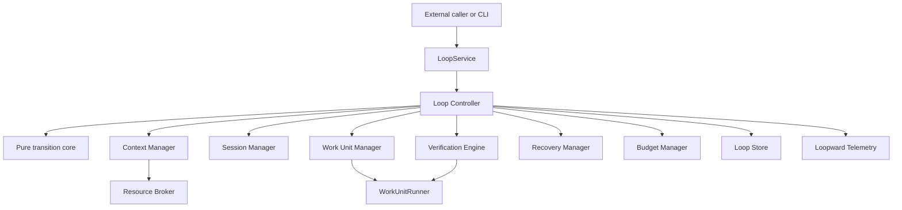
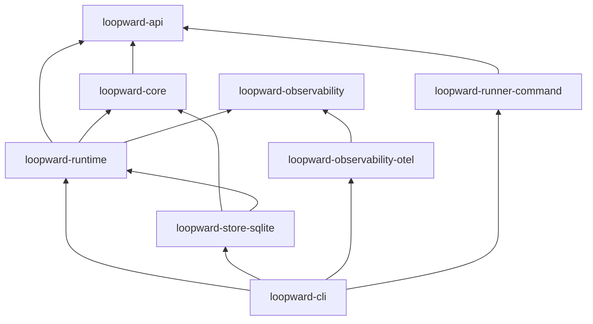

# System Architecture

**Status:** Draft for review  
**Version:** 0.1

## 1. Architectural Layers



The Loop Controller is deterministic wherever a transition can be decided from structured state, policy, verification, and observed results. An LLM MAY propose a plan or semantic judgment; it MUST NOT own lifecycle integrity.

## 2. Workspace Layout

```text
loopward/
├── crates/
│   ├── loopward-api/
│   ├── loopward-core/
│   ├── loopward-runtime/
│   ├── loopward-store-sqlite/
│   ├── loopward-observability/
│   ├── loopward-observability-otel/
│   ├── loopward-runner-command/
│   ├── loopward-cli/
│   └── loopward-testkit/
├── schemas/
├── docs/
└── examples/
```

## 3. Crate Responsibilities

### `loopward-api`

Stable public contracts:

- typed identifiers;
- `LoopService`;
- `WorkUnitRunner`;
- request, result, event, and capability DTOs;
- trace carriers;
- suspension and cancellation contracts;
- opaque external references;
- wire-level errors and schema versions.

It MUST NOT contain the Loop Controller, Store implementation, Context Manager, or OpenTelemetry SDK.

### `loopward-core`

Pure domain model and state-transition logic:

- Loop, Episode, Session, Work Unit, Attempt, and Checkpoint types;
- constraints, decisions, observations, resources, and verification outcomes;
- transition validation;
- mutation validation;
- completion assessment;
- invariants and pure reducers.

It MUST NOT depend on Tokio, SQLite, OpenTelemetry, or vendor SDKs.

### `loopward-runtime`

Lifecycle engine:

- Loop Controller;
- Session Manager;
- Context Manager;
- Work Unit Manager;
- Checkpoint Manager;
- Verification Engine;
- Recovery Manager;
- Budget Manager;
- storage and telemetry ports.

It MUST NOT depend on a concrete Store, runner, or exporter implementation.

### `loopward-store-sqlite`

Phase One durable storage:

- transactions;
- projections;
- immutable Checkpoints;
- Event Journal;
- leases and fencing;
- schema migrations;
- resource metadata.

### `loopward-observability`

Backend-neutral observability contract:

- semantic convention names;
- trace-completeness types;
- telemetry facade;
- no-op implementation;
- test recorder.

### `loopward-observability-otel`

OpenTelemetry adapter:

- W3C Trace Context;
- OTLP exporter configuration;
- Episode traces and span links;
- Rust `tracing` bridge;
- bounded flush;
- telemetry degradation reporting.

It MUST NOT provide storage, querying, dashboards, or a Web UI.

### `loopward-runner-command`

Local process runner:

- structured request/result files;
- trace propagation;
- stdout/stderr capture;
- bounded interruption;
- result validation;
- resource materialization.

### `loopward-cli`

Application composition root and operator interface.

### `loopward-testkit`

Scripted runners, failure injection, deterministic clocks, in-memory ports, and conformance suites.

## 4. Dependency Rules



Adapters point toward public contracts. Core crates MUST NOT depend on adapters.

## 5. Controller Components

### Loop Controller

The only component allowed to advance Loop lifecycle state.

### Context Manager

Constructs bounded, auditable Boot Packages. It is a first-class component, not a helper inside Session Manager.

### Session Manager

Allocates generations and manages start, drain, close, and rotation safe points.

### Work Unit Manager

Validates Work Units, manages Attempts, propagates trace context, invokes explicitly provided runners, and collects results.

### Checkpoint Manager

Validates mutations, resources, concurrency, and atomic Checkpoint commits.

### Verification Engine

Executes versioned Verification Plans and separates operation errors from criterion failures.

### Recovery Manager

Reconciles external execution, ambiguous side effects, dead Sessions, and partial progress.

### Budget Manager

Tracks context, model tokens, wall time, attempts, cost, and resource volume. It emits policy signals; the Loop Controller chooses transitions.

## 6. Primary Execution Flow

```text
Load Checkpoint
→ select bounded Work Unit
→ assemble Boot Package
→ start fresh Runtime Session
→ persist Attempt intent
→ execute runner
→ collect structured result
→ drain Session
→ validate and verify
→ commit Checkpoint
→ close Episode
→ continue, remediate, suspend, complete, or fail
```

Every Episode ends at a durable boundary before another Episode begins.
