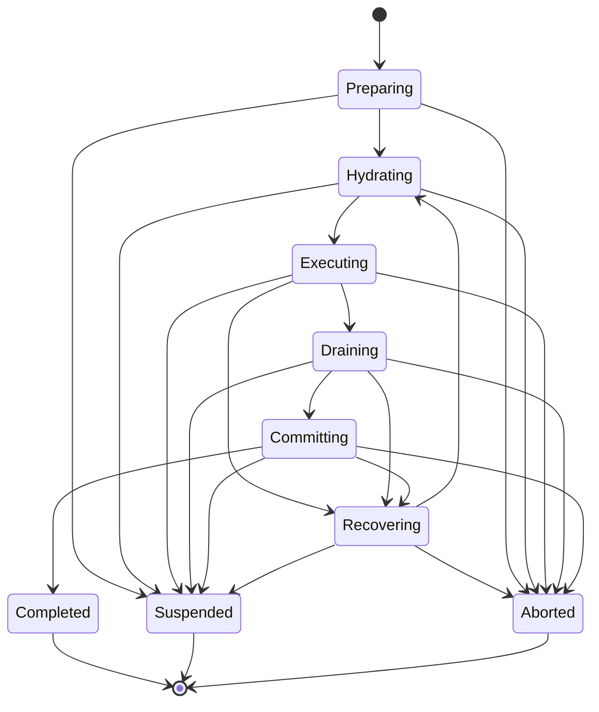
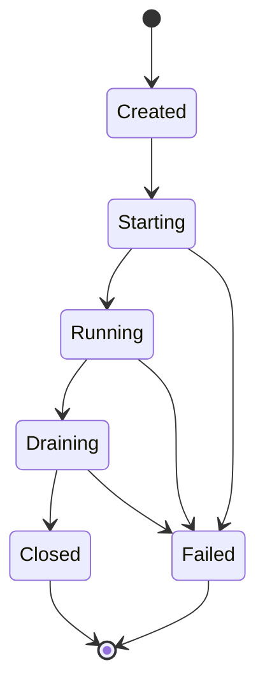
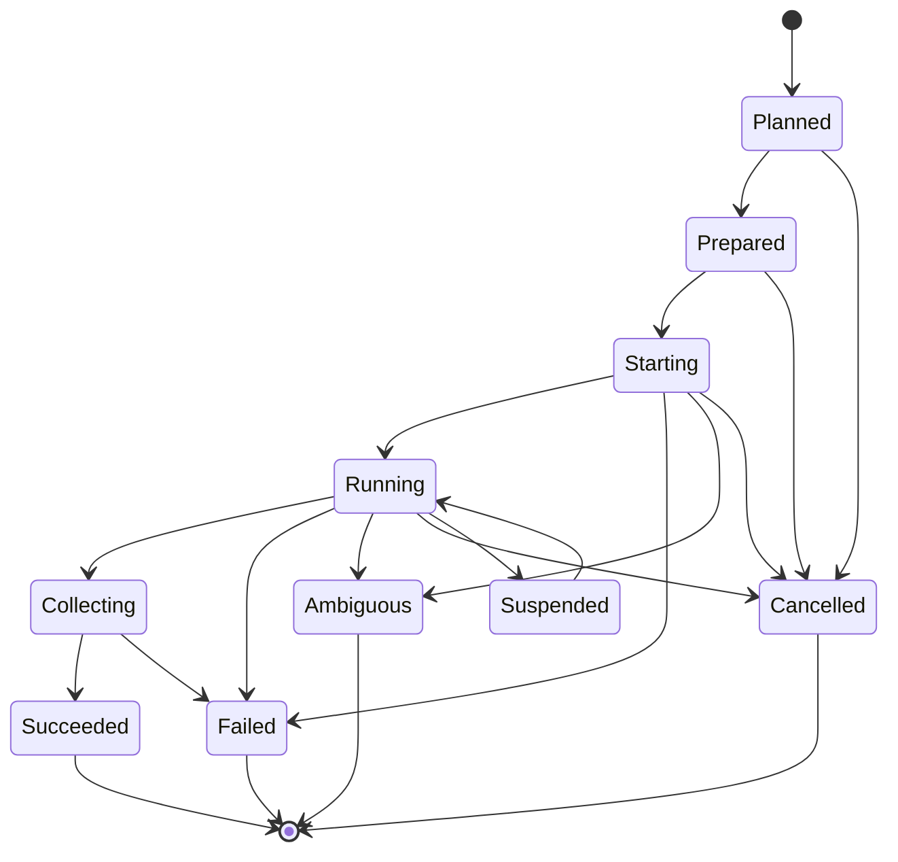

# Session Rotation

## 1. Purpose

Session rotation is a first-class lifecycle event, not an emergency response to an almost-full context window.

Loopward rotates Runtime Sessions to:

- bound repeated context processing;
- isolate phases and local objectives;
- remove stale or contradictory working context;
- create independent verification contexts;
- recover from runner or session failure;
- preserve durable progress across replaceable reasoning environments.

## 2. Lifecycle Separation

Loopward uses separate state machines for Episode, Runtime Session, and Work Unit Attempt. Their boundaries often align, but they are not the same entity.

## 3. Episode State Machine



Every terminal Episode state produces a committed Checkpoint or references an already committed terminal Checkpoint.

## 4. Runtime Session State Machine



A closed or failed Runtime Session generation is never reopened. Continuation creates the next generation.

## 5. Work Unit Attempt State Machine



Attempt success means a result was collected. It does not mean the Work Unit was accepted.

## 6. Normal Rotation Sequence

```text
Rotation signal
    ↓
Record rotation intent
    ↓
Stop admitting new work to the current Session
    ↓
Drain runner and collect structured handoff
    ↓
Validate result, resources, and handoff
    ↓
Run required verification
    ↓
Commit Checkpoint
    ↓
Close current Session generation
    ↓
Create next Episode and Session generation
    ↓
Hydrate a new Boot Package
```

If drain fails, Loopward records the failure and follows recovery policy. It does not fabricate a successful handoff.

## 7. Rotation Reasons

```rust
pub enum RotationReason {
    WorkUnitBoundary,
    PhaseBoundary,
    VerificationBoundary,
    RemediationBoundary,
    GoalLocalityShift,
    SoftContextBudget,
    HardContextBudget,
    ContextIntegrityFailure,
    ContextEntropySignal,
    RunnerCompaction,
    RunnerFailure,
    Recovery,
    Policy,
    OperatorRequest,
}
```

The rotation record stores both the primary reason and all contributing signals.

## 8. Phase One Policy

Phase One uses deterministic rotation:

- fresh Runtime Session for each Work Unit by default;
- fresh Runtime Session for verification;
- mandatory rotation at phase boundaries;
- mandatory rotation after context integrity failure;
- mandatory closure after runner failure;
- hard context budget terminates admission and initiates drain;
- soft context budget recommends rotation at the next safe boundary.

Runtime Session reuse is an opt-in experiment. It is not the default architecture.

## 9. Rotation Record

```rust
pub struct RotationRecord {
    pub loop_id: LoopId,
    pub episode_id: EpisodeId,
    pub from_session_id: SessionId,
    pub from_generation: u32,
    pub to_generation: Option<u32>,
    pub primary_reason: RotationReason,
    pub signals: Vec<RotationSignal>,
    pub checkpoint_ref: CheckpointRef,
    pub prior_manifest_ref: ResourceRef,
    pub next_budget: ContextBudget,
    pub trace_links: Vec<TraceRef>,
    pub created_at: Timestamp,
}
```

## 10. Budget Behavior

Soft and hard limits have different semantics:

- Soft limit: finish the current safe unit of work, then rotate.
- Hard limit: stop admitting additional model work, request drain, and close.

If a runner does not expose token usage, Loopward can use conservative observable proxies such as materialized Boot Package size, tool-output size, or runner-declared limits. The telemetry records the proxy and uncertainty.

## 11. Compaction Events

If a runner reports internal compaction:

- Loopward records the event;
- validates any supplied pinned digest;
- may require rotation according to policy;
- does not treat vendor compaction as a committed Checkpoint;
- does not assume the compacted session is equivalent to a newly hydrated Session.

## 12. Suspension During Rotation

Rotation can suspend when:

- required handoff data is missing;
- external execution state is ambiguous;
- pinned constraints do not match;
- a required resource is unavailable;
- verification requests human input;
- a policy decision is required.

Suspension commits the best-known durable state before releasing the execution lease when safe.

## 13. Episode and Trace Segmentation

One Episode corresponds to one top-level trace. A long Loop is therefore represented by a sequence of trace-linked Episodes rather than one indefinitely open trace.

The Checkpoint is both:

- the durable continuation boundary;
- the trace segmentation boundary.

The next Episode links to the prior Episode and records the Checkpoint from which it was hydrated.

## 14. Runtime API Semantics

`advance(loop_id)` performs at most one durable Episode transition to a safe boundary.

`run_until(loop_id, condition)` repeatedly advances with explicit limits:

- deadline;
- maximum Episodes;
- maximum resource cost;
- cancellation token;
- suspension condition.

An unbounded hidden execution loop is not part of the public API.

## 15. Acceptance Criteria

Session rotation is acceptable when:

- a Runtime Session generation is never reused after closure;
- every rotation has a reason, signals, and Checkpoint;
- verification can run without implementation-session history;
- hard budget exhaustion cannot silently continue execution;
- crashes during drain or commit have deterministic recovery behavior;
- the next Session can start solely from durable state and resource references;
- Loop tracing remains usable without a single long-lived trace.

