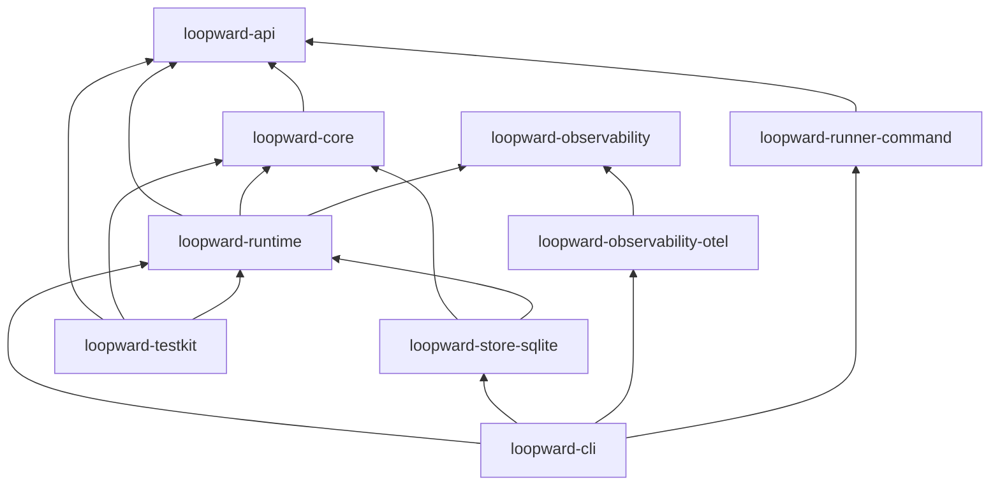

# Loopward: Internal Architecture Wiki

Loopward is a lifecycle framework for durable, context-efficient agent work spanning bounded, replaceable Runtime Sessions. It keeps authoritative Loop state outside runner conversations and reconstructs bounded context for each Work Unit.

Phase One is specified as a Rust workspace with pure lifecycle transitions, a port-driven runtime, SQLite durability, command-runner boundaries, explicit verification and recovery, and backend-neutral tracing. This wiki describes intended architecture only; implementation has not been assessed.

> **Audience:** developers **of** Loopward itself. Consumer-facing
> documentation (READMEs, tutorials, API docs) lives elsewhere and is not
> duplicated here.

## System Map

## Page Index

| Page | Covers | Summary |
|---|---|---|
| [Public API](public-api.md) | loopward-api | Stable service, runner, DTO, versioning, and security contracts. |
| [Core Domain](core-domain.md) | loopward-core | Durable entities, invariants, and pure lifecycle transitions. |
| [Runtime Lifecycle](runtime-lifecycle.md) | loopward-runtime | Controller, Episode, Session, rotation, budget, and continuation behavior. |
| [Context Management](context-management.md) | runtime context subsystem | Hydration, Boot Packages, resources, compaction, and context budgets. |
| [Work Unit Execution](work-unit-execution.md) | runner boundaries | Work Units, Attempts, runner protocol, external effects, and cancellation. |
| [Durable State](durable-state.md) | loopward-store-sqlite | Transactions, Checkpoints, journal, leases, fencing, and recovery. |
| [Verification and Recovery](verification-recovery.md) | runtime verification and recovery | Gates, remediation, completion, reconciliation, and no-progress handling. |
| [Observability](observability.md) | observability crates | Trace contracts, OTLP adapter, propagation, metrics, and degradation. |
| [CLI and Testkit](cli-and-testkit.md) | composition and evaluation | Operator commands, conformance tests, failure injection, and evaluation scenarios. |

## Maintenance Convention

Every page ends with a **Source Anchors** section that separates
Specification Sources from Implementation Sources. **Rule:** a change under
either category updates the page or records why not. Drift is detectable
mechanically: `git log <last-commit-touching-page>.. -- <anchors>` lists
pages whose sources moved without them; the wiki skills' refresh modes
automate this. There is deliberately no CI freshness gate: gates train
contributors to make no-op doc edits. Run the materialized `check-wiki.sh`
(in `scripts/` or alongside this file) to verify structural conventions.

## Page Conventions

Copy [TEMPLATE.md](TEMPLATE.md) for new pages: nine sections in order;
Mermaid-only diagrams; no line numbers (function/type/file names only);
links target only canonical page filenames; every Key Decision cites a real
PR number or commit SHA; known debt appears only under Implementation
Notes. Target 150–350 lines per page; if a draft exceeds ~400 lines it is
over-scoped.
