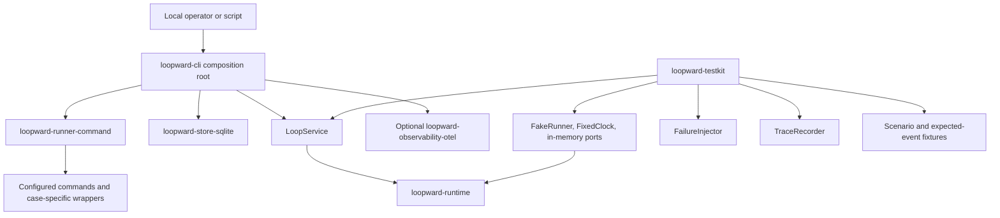

# CLI and Testkit

## Purpose

The CLI and testkit make Loopward operable and measurable without creating an alternative lifecycle engine. `loopward-cli` is the Phase One composition root: normal lifecycle commands use the public `LoopService`, while inspection and integrity commands use a separate authorization-controlled administrative boundary. Mutating lifecycle requests are versioned, idempotent, and concurrency-aware. `loopward-testkit` supplies deterministic clocks, scripted runners, in-memory ports, trace recording, fixtures, and failure injection for conformance tests. Together they prove bounded execution, recovery, context carry, and trace continuity while keeping real-runner comparisons explicitly separate from deterministic correctness claims.

## Position in the System

`loopward-cli` sits at the outermost application boundary. It composes [Runtime Lifecycle](runtime-lifecycle.md) with the SQLite adapter from [Durable State](durable-state.md), the command runner from [Work Unit Execution](work-unit-execution.md), and the optional OpenTelemetry adapter from [Observability](observability.md). It submits versioned requests through [Public API](public-api.md); it does not call reducers, mutate the store directly, or implement privileged lifecycle transitions.

`loopward-testkit` consumes the public contracts, pure [Core Domain](core-domain.md) transitions, runtime ports, and observable lifecycle boundaries. Its fakes replace clocks, identifiers, runners, storage-facing ports, and telemetry services so tests can control time, outcomes, failures, and trace evidence. The testkit exercises [Context Management](context-management.md), verification, reconciliation, and completion through the normal runtime boundary described in [Verification and Recovery](verification-recovery.md).

The generic command runner is the only real execution adapter in Phase One. Configured agent commands and external systems remain behind runner profiles or case-specific wrappers; neither the CLI nor testkit introduces vendor concepts, orchestration topology, a telemetry backend, or a Web UI.

## Architecture



The CLI configuration resolves the database path, resource root, run root, lease duration, runner profile, and whether tracing is enabled. Tracing defaults to disabled. When enabled, the optional adapter uses deployment-supplied standard OpenTelemetry environment variables; the CLI does not start or bundle a telemetry service.

The Phase One operator surface is:

```text
loopward init
loopward create --spec <path>
loopward advance <loop-id>
loopward run <loop-id> --max-episodes <n>
loopward status <loop-id>
loopward events <loop-id>
loopward suspend <loop-id>
loopward resume <loop-id>
loopward cancel <loop-id>
loopward inspect-checkpoint <loop-id>
loopward verify-store
```

`advance` progresses to the next safe durable boundary. `run` maps to a bounded `run_until` request and must carry at least one finite limit; the illustrated CLI exposes `--max-episodes`, while the public contract also permits deadline or resource-cost limits. Mutating commands construct versioned requests with idempotency metadata. Human-readable output is concise, and supported `--json` output uses versioned response DTOs rather than an ad hoc CLI schema.

The testkit components have narrow responsibilities:

- `FakeRunner` returns outcomes scripted by Attempt ordinal.
- `FixedClock` advances only when a test requests it.
- deterministic identifiers make lifecycle and journal assertions reproducible.
- in-memory ports isolate runtime conformance from SQLite, processes, and external services when those adapters are not under test.
- `FailureInjector` exposes the eight specified crash points.
- `TraceRecorder` captures span names, attributes, links, and redaction evidence without an external telemetry service.
- scenario fixtures define Work Units, verification outcomes, and expected durable events independently of test control flow.

The deterministic reference scenario contains five Episodes—Inspect, Implement, Verify, Remediate, and Final Verify—with a rejected verification result before remediation and completion. A separate stress fixture represents more than 100,000 tokens of prior history while targeting a final Boot Package of no more than 30,000 estimated tokens. That number is a fixture target, not a framework-wide default.

Comparative evaluation uses the command runner rather than testkit fakes. It can execute a scripted runner for reproducible protocol conformance or a configurable real agent command for measurement. External wrappers translate public `WorkUnitRequest` and `WorkUnitResult` contracts or invoke `LoopService`; they own translation, lineage, cancellation, and deployment-policy safeguards without copying either system's internal state machine.

## Runtime Flows

1. **Compose the application and execute a finite operator command.**
   1. `loopward-cli` resolves storage, resource, run, lease, runner-profile, and tracing configuration.
   2. It constructs the SQLite store, command runner, runtime service, and either no-op telemetry or the optional OpenTelemetry adapter.
   3. For a mutating lifecycle command, the selected subcommand builds a versioned public request with request identity, idempotency key, expected revision where applicable, and trace context; read-only and administrative operations do not construct lifecycle idempotency keys.
   4. `advance` asks `LoopService` to reach one safe durable boundary; `run` supplies a finite limit and is rejected as `InvalidRequest` when none is present.
   5. The CLI renders a concise operator result or a versioned JSON DTO. It never bypasses runtime validation to mutate Checkpoints, Events, leases, or lifecycle state.

2. **Run deterministic conformance and the five-Episode reference scenario.**
   1. The harness supplies a `FixedClock`, deterministic identifiers, in-memory ports, `FakeRunner`, `TraceRecorder`, and the reference fixtures.
   2. The scripted runner drives Inspect, Implement, rejected Verify, Remediate, and accepted Final Verify outcomes by Attempt ordinal.
   3. The runtime creates a fresh Session generation for every Work Unit, preserves pinned constraints, records remediation lineage, and admits only verified evidence into accepted state.
   4. The harness asserts five bounded Episodes and five top-level traces, links between consecutive Episode traces, the expected durable event sequence, and final success criteria supported by current evidence.
   5. It also asserts that the final Boot Package contains current bounded inputs and archived-history references rather than the full prior history.

3. **Inject a failure and verify reconciliation.**
   1. `FailureInjector` selects one of the eight named boundaries: before runner start; after external start but before handle persistence; during execution; after result materialization; during verification; before the Checkpoint transaction; after Checkpoint commit but before acknowledgement; or during Session drain.
   2. The harness interrupts execution at that precise boundary and then resumes through the normal recovery path.
   3. The Recovery Manager reconciles durable intent, external handles or ambiguity, results, verification state, Checkpoint version, Session state, and fencing information as applicable.
   4. The test compares the resulting durable state and events with the expected outcome for that failure point.
   5. Success means accepted work is neither lost nor blindly repeated, and ambiguous external effects remain explicitly unresolved until evidence permits a decision.

4. **Run comparative real-runner evaluation.**
   1. An evaluator selects command-runner profiles without adding agent or vendor types to Core.
   2. The same Work Unit protocol fixture is run with a fresh Session per Work Unit and, where a runner supports it, a runner-managed continuous Session profile.
   3. The report records Boot Package estimates and estimation methods, reported input and output tokens or `unavailable`, accepted transitions, repeated reads and work, verification outcomes, duration, recovery events, and trace references.
   4. The evaluator compares context carry, rework, verification quality, time to accepted completion, and reported token use.
   5. Missing runner metrics remain unavailable; deterministic conformance results and empirical real-runner observations are not blended into one correctness claim.

## Key Decisions

### Keep the CLI on the public service boundary

- **Decision:** Every CLI operation is a client of `LoopService` or an authorization-controlled administrative boundary, not a privileged state machine.
- **Rationale:** No PR or design doc records a rationale; observed current state: the API and MVP specifications require public calls to be finite, idempotent, concurrency-aware, and shared by the local operator interface.
- **Consequences:** CLI behavior exercises the same lifecycle checks as other clients, and store inspection or integrity operations remain separate from normal execution.
- **Ref:** `docs/09-public-api.md` (sections 2–4 and 9: Inbound Loop Service; Finite Operations; Command Metadata; Administrative Access); `docs/10-mvp-and-evaluation.md` (section 11: CLI Surface).

### Require finite limits for multi-Episode runs

- **Decision:** `loopward run` must map to `run_until` with at least one explicit finite limit and fail with `InvalidRequest` when no limit is provided.
- **Rationale:** The public API forbids calls that conceal unbounded work, and the Phase One CLI contract explicitly tests the missing-limit case.
- **Consequences:** Operators must bound automatic progress; `advance` remains available for one-boundary control.
- **Ref:** `docs/09-public-api.md` (section 3: Finite Operations); `docs/10-mvp-and-evaluation.md` (section 11: CLI Surface); `docs/superpowers/plans/2026-07-29-loopward-phase-one.md` (Task 12: Implement the CLI Composition Root).

### Separate deterministic conformance from real-runner evaluation

- **Decision:** Scripted fakes establish protocol and lifecycle correctness, while configurable command-runner profiles produce separately attributed comparative measurements.
- **Rationale:** The evaluation specification defines distinct deterministic and real-runner layers and requires unavailable runner metrics to remain unavailable.
- **Consequences:** Reproducible assertions do not depend on a model or vendor, while empirical reports can compare runner behavior without presenting estimates or absent data as facts.
- **Ref:** `docs/10-mvp-and-evaluation.md` (sections 6 and 9–10: Reference Scenario; Evaluation Layers; Success Metrics).

### Make failure recovery a conformance surface

- **Decision:** The testkit injects failures at all eight specified lifecycle boundaries and verifies the expected reconciliation outcome for each.
- **Rationale:** Phase One exists to prove that verified state transitions survive crashes and retries without losing accepted work or blindly repeating ambiguous effects.
- **Consequences:** Recovery behavior must be observable and deterministic under controlled interruption; passing only happy-path scenarios is insufficient for Phase One acceptance.
- **Ref:** `docs/10-mvp-and-evaluation.md` (sections 2, 8, and 13: Hypotheses; Failure Injection Matrix; Phase One Acceptance Gates); `docs/superpowers/plans/2026-07-29-loopward-phase-one.md` (Task 13: Build Testkit, Reference Scenario, and Evaluation Harness).

### Keep composition static and integrations external

- **Decision:** Phase One uses the generic command runner plus case-specific public-API wrappers; it does not add runtime plugin discovery, orchestration concepts, or vendor adapters to Core.
- **Rationale:** The charter and risk decisions explicitly place cross-system composition in wrappers and freeze the command runner as the reference execution adapter.
- **Consequences:** Wrapper authors own translation and deployment safeguards, while Loopward retains its lifecycle state and external systems retain theirs.
- **Ref:** `docs/00-project-charter.md` (section 6: Relationship to External Systems); `docs/09-public-api.md` (section 13: Wrapper Integration); `docs/11-risks-and-open-questions.md` (sections 1.10–1.11 and 5: Rebuilding an Orchestration Framework; Recursive Wrapper Composition; Decision Record).

### Exclude operator presentation and telemetry infrastructure

- **Decision:** The CLI remains a local textual/JSON interface; Phase One ships no Web UI, Web Preview, dashboard, telemetry backend, or service started by the CLI.
- **Rationale:** These capabilities are explicitly outside the charter, architecture boundary, and MVP scope.
- **Consequences:** Deployments provide any desired visualization or telemetry service, and conformance remains runnable with tracing disabled and without external infrastructure.
- **Ref:** `docs/00-project-charter.md` (section 4: Non-Goals); `docs/01-system-architecture.md` (section 3: Crate Responsibilities); `docs/10-mvp-and-evaluation.md` (sections 4 and 13: Excluded Scope; Phase One Acceptance Gates).

## Implementation Notes

- **Invariant:** `loopward-cli` is the application composition root, not an owner of domain transitions.
- **Invariant:** `run` requires at least one finite limit; `advance` stops at the next safe durable boundary.
- **Invariant:** Mutating CLI commands use versioned requests and idempotency metadata.
- **Output boundary:** JSON output consists of versioned public response DTOs; human-readable output is a presentation of the same results.
- **Configuration boundary:** Tracing defaults to disabled, and enabling OTLP uses deployment configuration without starting an embedded service.
- **Testing boundary:** Deterministic conformance requires no external runner, clock, telemetry backend, or Web UI.
- **Fake-runner contract:** Scripted outcomes are selected by Attempt ordinal so retries and remediation remain reproducible.
- **Clock contract:** The fixed clock moves only under explicit test control.
- **Failure coverage:** Each of the eight injection points has an expected reconciliation and recovery result.
- **Reference fixture:** The five Episodes are Inspect, Implement, Verify, Remediate, and Final Verify; verification rejection precedes remediation and accepted completion.
- **Stress fixture:** More than 100,000 tokens of represented history and a no-more-than-30,000 estimated-token final Boot Package are evaluation-fixture values, not universal defaults.
- **Measurement boundary:** Token figures are labeled as reported, estimated with method, or unavailable. Unavailable metrics are never inferred.
- **Comparison boundary:** Fresh-Session and runner-managed continuous-Session profiles are comparative evaluation modes, not alternative Core lifecycle semantics.
- **Integration boundary:** Configured agent commands belong in command-runner profiles; external-system integration belongs in case-specific wrappers.
- **Wrapper safeguards:** Execution lineage, nesting limits, inherited resource budgets, cancellation propagation, and cycle detection are wrapper or deployment-policy concerns where recursive composition is possible.
- **Scope boundary:** No Aether, DAG, scheduler, agent registry, plugin marketplace, telemetry backend, dashboard, or Web UI belongs in Phase One.
- **Specification status:** The CLI and testkit design is specified but implementation has not been assessed.

## Spec Deviations

Implementation has not been assessed.

## Source Anchors

### Specification Sources

- `docs/00-project-charter.md` (sections 3–7: Goals through Technology Baseline)
- `docs/01-system-architecture.md` (sections 1–5: Architectural Layers through Controller Components)
- `docs/05-work-unit-and-runner-protocol.md` (sections 13–15: Command Runner through Acceptance Criteria)
- `docs/08-tracing-and-observability.md` (sections 13–15: Sampling and Reliability through Acceptance Criteria)
- `docs/09-public-api.md` (sections 2–4 and 9–14: Inbound Loop Service through Wrapper Integration and Acceptance Criteria)
- `docs/10-mvp-and-evaluation.md` (sections 1–13: Objective through Phase One Acceptance Gates)
- `docs/11-risks-and-open-questions.md` (sections 1.10–1.11, 2.3–2.4, 4, and 5: Composition Risks; Session Reuse; Extension; Acceptance Criteria; Decision Record)
- `docs/superpowers/plans/2026-07-29-loopward-phase-one.md` (Global Constraints; File and Crate Map; Tasks 12–14)

### Implementation Sources

Implementation has not been assessed.

## Related Pages

- [Public API](public-api.md)
- [Core Domain](core-domain.md)
- [Runtime Lifecycle](runtime-lifecycle.md)
- [Context Management](context-management.md)
- [Work Unit Execution](work-unit-execution.md)
- [Durable State](durable-state.md)
- [Verification and Recovery](verification-recovery.md)
- [Observability](observability.md)
