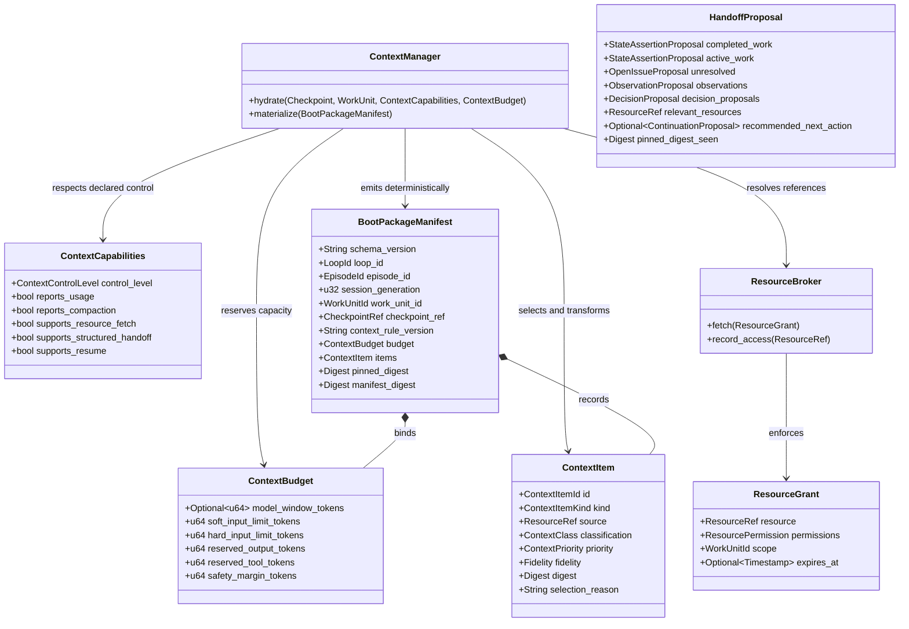

# Context Management

## Purpose

Context management reconstructs bounded, task-specific input for each replaceable Runtime Session without treating conversation history as authoritative state. The `loopward-runtime` Context Manager constructs bounded, auditable Boot Packages. The deterministic hydration pipeline uses a committed Checkpoint, current Work Unit, declared runner capabilities, and an explicit context budget; pinned constraints remain lossless, while every materialized item records provenance and a selection reason. (`docs/01-system-architecture.md`, section 5: Controller Components; `docs/04-context-lifecycle.md`, sections 1–7: Purpose through Boot Package)

## Position in the System

The Context Manager is a first-class component of `loopward-runtime`, separate from the Session Manager. The Loop Controller invokes it in the primary execution flow to assemble a Boot Package, and the architecture connects it to the Resource Broker. (`docs/01-system-architecture.md`, sections 1, 5, and 6: Architectural Layers; Controller Components; Primary Execution Flow)

The Context Manager constructs the bounded package used by [Work Unit Execution](work-unit-execution.md). The Loop Controller alone advances lifecycle state; Session rotation, verification, and Checkpoint commit remain runtime lifecycle responsibilities rather than Context Manager responsibilities. (`docs/01-system-architecture.md`, sections 5 and 6: Controller Components; Primary Execution Flow; `docs/07-session-rotation.md`, section 6: Normal Rotation Sequence)

## Architecture

`ContextCapabilities` records the runner's actual level of context control: `Opaque`, `Observable`, `ManagedBoot`, or `Managed`. Capability discovery is descriptive; the Context Manager cannot assume incremental resource fetch, structured handoff, resume, usage reporting, or compaction reporting unless the runner declares it. (`docs/04-context-lifecycle.md`, section 3: Context Capability Levels)

Before materializing payloads, the Context Manager represents candidates as `ContextItem` metadata. Classification separates `Pinned`, `CurrentState`, `CurrentWork`, `Decision`, `Evidence`, `Reference`, and `RecentOutcome`; priority orders `Required`, `Important`, `Supplemental`, and `OnDemand` material. Fidelity ranges from `Verbatim` and `Structured` to `Excerpt`, `Summary`, and `ReferenceOnly`, but pinned constraints require verbatim or lossless structured representation. (`docs/04-context-lifecycle.md`, section 4: Context Item Model)

`ContextBudget` prevents boot input from consuming the whole model window. It distinguishes soft and hard input limits and reserves output, tool, and safety capacity. Token estimates retain their method and confidence, while unavailable usage remains unknown rather than being represented as fabricated precision. (`docs/04-context-lifecycle.md`, section 5: Context Budget)

`BootPackageManifest` is the stable, Loopward-owned layer of a Boot Package. It binds the selected items and budget to the Loop, Episode, Session generation, Work Unit, Checkpoint, selection-rule version, and pinned-state digest. A runner-specific Markdown, JSON, file, or command-line payload is derived from that manifest but is not authoritative state. (`docs/04-context-lifecycle.md`, section 7: Boot Package; `docs/schemas/boot-package-manifest-v0.1.yaml`)

`ResourceGrant` scopes retrieval permissions to an active Work Unit, with optional expiry. The Resource Broker makes access auditable, enforces permissions, and checks immutable digests when required. Runners without scoped retrieval support instead receive a fully materialized Boot Package that fits the budget. (`docs/04-context-lifecycle.md`, section 8: Resource References and On-Demand Retrieval)

`HandoffProposal` separates completed and active work, unresolved issues, observations, decision proposals, resources, and a recommended next action. It is an untrusted proposal. Before Checkpoint commit, the runtime validates its schema, pinned digest, evidence, resource versions when applicable, claim status, policy, and conflicts with active decisions. The specifications do not assign this validation to the Context Manager. (`docs/04-context-lifecycle.md`, section 9: Compaction and Structured Handoff; `docs/07-session-rotation.md`, section 6: Normal Rotation Sequence)

## Runtime Flows

1. **Hydrate a Runtime Session deterministically.** The Context Manager receives the committed Checkpoint, bounded Work Unit, declared `ContextCapabilities`, and `ContextBudget`. It validates pinned state and resource digests, selects required material, then applicable decisions, verified observations, current Work Unit inputs, and recent outcomes. It applies fidelity transformations, fits important and supplemental items into the remaining budget, emits a `BootPackageManifest`, and only then materializes the runner-specific payload. Required pinned state, unresolved required resources, immutable digest mismatch, hard-budget overflow, or invalid materialization fails hydration before a runner or Work Unit Attempt starts. (`docs/04-context-lifecycle.md`, sections 6 and 12: Deterministic Hydration Pipeline; Failure Semantics)
2. **Assemble and audit a Boot Package.** Each selected `ContextItem` carries provenance, classification, priority, fidelity, validity, digest, estimate metadata, and a selection reason. The manifest records both inclusion decisions and the deterministic inputs needed for replay, binds the result to pinned state, and provides a comparison point for later rework analysis. The same input state and context-rule version must produce the same manifest. (`docs/04-context-lifecycle.md`, sections 4, 6, and 7: Context Item Model; Deterministic Hydration Pipeline; Boot Package)
3. **Retrieve a large resource on demand.** When a runner declares scoped retrieval support, the Boot Package can carry a `ResourceRef` rather than the payload. A `ResourceGrant` restricts the fetch to the active Work Unit and authorized operations; the Resource Broker enforces access, verifies the digest for immutable content, and records a resource-access event. Without this declared capability, the Context Manager must select and materialize content within the package budget rather than assume later retrieval. (`docs/04-context-lifecycle.md`, sections 3 and 8: Context Capability Levels; Resource References and On-Demand Retrieval)
4. **Compact, validate, and rotate.** A rotation signal stops new work admission, drains the runner, and collects a structured `HandoffProposal`. The runtime validates the result, resource references, pinned digest, evidence, workspace or resource versions, claim status, policy, and decision conflicts, then runs required verification before committing a Checkpoint. Only after that durable boundary does it close the current Session generation, create a successor when needed, and hydrate a new Boot Package. Failed drain or missing handoff data follows recovery or suspension policy; vendor compaction is recorded but is neither a committed Checkpoint nor proof of continuity. (`docs/04-context-lifecycle.md`, section 9: Compaction and Structured Handoff; `docs/07-session-rotation.md`, sections 6, 11, and 12: Normal Rotation Sequence; Compaction Events; Suspension During Rotation)

## Key Decisions

### Keep execution history retrievable instead of carrying it by default

- **Decision:** Durable history remains available through state and resource references but is not automatically copied into every Runtime Session.
- **Rationale:** The charter identifies repeated processing of irrelevant historical context as a runtime resource problem and establishes that context is reconstructed for current work rather than inherited from a continuously growing conversation.
- **Consequences:** Hydration selects only applicable decisions, verified observations, current inputs, and useful recent outcomes; developers must preserve provenance so omitted history remains recoverable when needed.
- **Ref:** `docs/00-project-charter.md` (sections 2 and 8: Motivation; Foundational Principles); `docs/04-context-lifecycle.md` (sections 1 and 2: Purpose; Governing Principles).

### Preserve pinned constraints losslessly

- **Decision:** Pinned constraints use verbatim or lossless structured fidelity and are integrity-bound through the manifest's pinned digest.
- **Rationale:** The project goals require policies, explicit constraints, and success criteria to survive Session replacement without lossy summarization.
- **Consequences:** A missing pinned item or digest mismatch prevents hydration or safe rotation, and a lossy summary cannot substitute for required constraints.
- **Ref:** `docs/00-project-charter.md` (sections 3 and 8: Goals; Foundational Principles); `docs/04-context-lifecycle.md` (sections 4.1, 4.3, 7, and 12: Context classes; Fidelity; Boot Package; Failure Semantics).

### Make runner context capability explicit

- **Decision:** Loopward records one of four context-control levels and individual runner capabilities rather than assuming managed context behavior.
- **Rationale:** Runners expose materially different degrees of visibility and control, so capability discovery is descriptive rather than aspirational.
- **Consequences:** Incremental retrieval, structured handoff, resume, compaction reporting, and usage reporting are available only when declared; unsupported behavior requires a bounded fully materialized package or an explicit conformance finding.
- **Ref:** `docs/04-context-lifecycle.md` (sections 3, 8, and 12: Context Capability Levels; Resource References and On-Demand Retrieval; Failure Semantics).

### Treat context capacity as a budgeted runtime resource

- **Decision:** Boot input obeys explicit soft and hard limits while reserving output, tool, and safety capacity.
- **Rationale:** The charter defines token and context capacity as managed runtime resources, and the context design states that boot context must not fill the entire model window.
- **Consequences:** Soft-limit signals recommend rotation at a safe boundary, hard limits stop new model-work admission and initiate drain, and all estimates retain method and uncertainty.
- **Ref:** `docs/00-project-charter.md` (section 8: Foundational Principles); `docs/04-context-lifecycle.md` (sections 5 and 11: Context Budget; Context Efficiency Metrics); `docs/07-session-rotation.md` (sections 8 and 10: Phase One Policy; Budget Behavior).

### Use deterministic selection and exclude semantic retrieval in Phase One

- **Decision:** Phase One uses versioned deterministic selection rules and does not use model-assisted relevance selection, vector retrieval, graph retrieval, or automatic semantic context selection.
- **Rationale:** The charter explicitly excludes semantic retrieval and automatic semantic context selection, while the context specification requires identical inputs and rule versions to produce the same manifest.
- **Consequences:** Selection remains auditable and replayable, individual deterministic entropy signals remain visible, and any later model-assisted selector must be recorded rather than becoming a hidden decision.
- **Ref:** `docs/00-project-charter.md` (section 4: Non-Goals); `docs/04-context-lifecycle.md` (sections 6 and 10: Deterministic Hydration Pipeline; Context Entropy Signals).

### Treat compaction as an untrusted state proposal

- **Decision:** A handoff or vendor compaction event cannot directly mutate authoritative state or substitute for a committed Checkpoint.
- **Rationale:** The governing principles define compaction as untrusted until validated, and the rotation design separates vendor compaction from durable Session continuation.
- **Consequences:** Handoff content undergoes schema, integrity, evidence, resource, verification, policy, and conflict validation; decision proposals require separate activation and failed validation may suspend rotation.
- **Ref:** `docs/04-context-lifecycle.md` (sections 2 and 9: Governing Principles; Compaction and Structured Handoff); `docs/07-session-rotation.md` (sections 6, 11, and 12: Normal Rotation Sequence; Compaction Events; Suspension During Rotation).

## Implementation Notes

- **Invariant:** Every materialized context item has provenance and a selection reason.
- **Invariant:** `Required` items must be present or hydration fails.
- **Invariant:** Pinned constraints use `Verbatim` or a lossless `Structured` representation.
- **Invariant:** Selection rules are versioned, and equal inputs plus an equal rule version produce the same Boot Package Manifest.
- **Invariant:** A runner is never credited with a context capability it did not declare.
- **Invariant:** Unknown token usage remains unknown; estimates and proxies record their method, confidence, and uncertainty.
- **Invariant:** Required pinned state, unavailable required resources, immutable digest mismatch, hard-budget overflow, and invalid materialization prevent runner start.
- **Invariant:** Decision proposals from a handoff do not become active decisions automatically.
- **Invariant:** Reconstruction must be observable without requiring sensitive context payloads to be recorded.
- **Phase One constraint:** Selection is deterministic; no large model selects boot context.
- **Phase One constraint:** Vector retrieval, graph retrieval, and automatic semantic context selection are excluded.
- **Phase One constraint:** A fresh Runtime Session is the default for every Work Unit and for verification; Session reuse is only an opt-in experiment.
- **Phase One constraint:** Context entropy remains a set of explicit deterministic signals rather than a single opaque score.
- **Acceptance requirement:** A late-stage Work Unit can execute from a bounded Boot Package independently of total Loop history.
- **Acceptance requirement:** Every Runtime Session can be reconstructed without prior conversation history, and all required constraints survive reconstruction losslessly.
- **Open follow-up:** Model-assisted relevance selection may be investigated after Phase One, but it must be explicit and recorded if introduced.
- **Open follow-up:** A composite context-entropy score may be introduced only with an explicit formula, inputs, and interpretation.

## Spec Deviations

Implementation has not been assessed.

## Source Anchors

### Specification Sources

- `docs/00-project-charter.md` (sections 2–4 and 8: Motivation; Goals; Non-Goals; Foundational Principles)
- `docs/01-system-architecture.md` (sections 1, 5, and 6: Architectural Layers; Controller Components; Primary Execution Flow)
- `docs/04-context-lifecycle.md` (sections 1–13: Purpose through Acceptance Criteria)
- `docs/07-session-rotation.md` (sections 6–11: Normal Rotation Sequence through Compaction Events)
- `docs/07-session-rotation.md` (section 12: Suspension During Rotation)
- `docs/schemas/boot-package-manifest-v0.1.yaml` (example manifest for schema version loopward.boot-package-manifest/v0.1)

### Implementation Sources

Implementation has not been assessed.

## Related Pages

- [Public API](public-api.md)
- [Core Domain](core-domain.md)
- [Runtime Lifecycle](runtime-lifecycle.md)
- [Work Unit Execution](work-unit-execution.md)
- [Durable State](durable-state.md)
- [Verification and Recovery](verification-recovery.md)
- [Observability](observability.md)
- [CLI and Testkit](cli-and-testkit.md)
