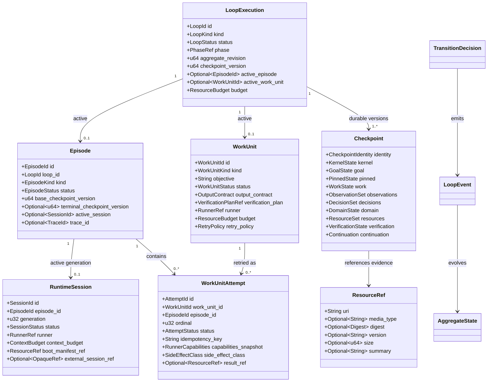

# Core Domain

## Purpose

The `loopward-core` crate defines Loopward's durable domain model, lifecycle invariants, and pure state transitions. It represents one long-running `LoopExecution` independently of any replaceable `RuntimeSession`, runner conversation, storage adapter, or telemetry backend. The core distinguishes attempts, produced results, verification, acceptance, and completion so that external execution cannot directly declare authoritative progress. Domain-specific state remains an opaque, schema-declared value rather than introducing coding, research, orchestration, or Aether concepts into the kernel.

## Position in the System

`loopward-core` depends inward on typed identifiers and public contract types from the [Public API](public-api.md). The [Runtime Lifecycle](runtime-lifecycle.md) invokes its pure transition and validation logic while retaining responsibility for I/O, coordination, and policy execution. The [Durable State](durable-state.md) adapter persists core entities, events, and immutable Checkpoints through runtime storage ports.

The [Verification and Recovery](verification-recovery.md) subsystem supplies structured verification outcomes and recovery observations that the core can reduce into authoritative state. [Work Unit Execution](work-unit-execution.md) produces results and proposals, but those proposals cross validation and verification gates before core state accepts them. The core must not depend on Tokio, SQLite, OpenTelemetry, vendor SDKs, concrete runners, or other adapters.

## Architecture

`LoopExecution` is the durable aggregate identity. In Phase One it has at most one active `Episode` and one active `WorkUnit`; terminal Loops cannot advance, and continuation is derived from durable state rather than Session history. An `Episode` is an attempt to move from one committed Checkpoint to the next durable semantic state and is also the top-level trace boundary.

`RuntimeSession` is a bounded execution environment associated with an Episode and generation. It carries a runner reference, context budget, Boot Package manifest reference, and optional opaque external Session reference, but it does not own Loop continuity. Closed and failed generations cannot return to running.

`WorkUnit` describes one externally observable unit of progress with explicit inputs, constraints, output contract, verification plan, runner, budget, and retry policy. Each execution is represented by a distinct `WorkUnitAttempt` with its own durable identity, ordinal, idempotency key, capabilities snapshot, Boot Package reference, side-effect class, and result reference. A Work Unit is not defined as one model call, agent, or external workflow.

`Checkpoint` is the versioned authoritative snapshot of current truth. It separates kernel, goal, pinned, work, observation, decision, domain, resource, verification, continuation, telemetry, and integrity state. A Checkpoint may represent pending verification, required remediation, suspension, or failure; being a safe recovery point does not imply success.

`Observation` represents evidence-supported or hypothesized state with a `VerificationStatus` of `Verified`, `Unverified`, or `Disproven`. A `Decision` represents a selected course of action, but a runner-produced Decision remains a proposal until an explicit decision gate activates it. Evidence is carried through `ResourceRef` values that must be immutable, version-addressed, or content-addressed when used as evidence.

The domain transition interface consists of pure synchronous `decide` and `evolve` operations. `decide` evaluates an `AggregateState`, `LifecycleCommand`, and `EffectivePolicy` to return a `TransitionDecision` or `DomainError`; `evolve` applies a `LoopEvent` to an `AggregateState`. Neither operation performs I/O.

## Runtime Flows

1. **Reduce a lifecycle command to durable events.** The runtime supplies `decide` with the current `AggregateState`, a `LifecycleCommand`, and the `EffectivePolicy`. The core checks lifecycle and mutation invariants and returns a `TransitionDecision` or `DomainError` without performing I/O. After the runtime durably records the selected `LoopEvent`, `evolve` applies that event to produce the next aggregate state. This keeps deterministic lifecycle authority in pure reducers while the runtime owns storage and effects.
2. **Advance through Loop, Episode, Session, Work Unit, Attempt, and Checkpoint boundaries.** A `LoopExecution` begins an `Episode` from a committed Checkpoint, associates a bounded `RuntimeSession` generation, and selects at most one active `WorkUnit`. Execution creates a distinct `WorkUnitAttempt`; closing or failing the Session does not terminate the Loop, and retrying creates another Attempt rather than overwriting the prior one. The Episode terminates only with a committed Checkpoint or a reference to an already committed terminal Checkpoint, after which durable `Continuation` determines whether another Episode begins.
3. **Assess acceptance and completion.** Runner completion first yields a produced result; it does not itself complete the Work Unit or Loop. The result is validated, verified against its `VerificationPlan`, and accepted before the Work Unit can be accepted. Loop completion is assessed separately against explicit success criteria and required verification gates, with no generic semantic-saturation rule and no authority granted to runner proposals.

## Key Decisions

### Keep the core pure and synchronous

- **Decision:** `loopward-core` contains domain types, invariant checks, transition validation, completion assessment, and pure reducers, while all I/O remains outside the domain layer.
- **Rationale:** No PR or design doc records a rationale; observed current state: the architecture assigns pure state-transition logic to `loopward-core`, forbids dependencies on Tokio, SQLite, OpenTelemetry, and vendor SDKs, and specifies synchronous `decide` and `evolve` functions that perform no I/O.
- **Consequences:** Lifecycle decisions can be tested deterministically and adapters remain outside the kernel; runtime components must translate external observations and effects into structured commands and events.
- **Ref:** `docs/01-system-architecture.md` (sections 1 and 3: Architectural Layers; Crate Responsibilities); `docs/02-core-domain-model.md` (section 12: Pure Transition Interface).

### Make the Loop durable and Sessions replaceable

- **Decision:** `LoopExecution` owns long-lived identity and continuation, while each `RuntimeSession` is bounded, generation-scoped, and permanently closed after closure or failure.
- **Rationale:** No PR or design doc records a rationale; observed current state: the project charter states that the Loop is durable, the Session is replaceable, state lives outside the Session, and context is reconstructed for current work.
- **Consequences:** Session closure does not terminate a Loop, continuation depends on durable state, and each next generation is hydrated from a Checkpoint and resource references rather than conversation history.
- **Ref:** `docs/00-project-charter.md` (sections 1, 3, and 8: Mission; Goals; Foundational Principles); `docs/02-core-domain-model.md` (sections 2 and 4: LoopExecution; RuntimeSession); `docs/07-session-rotation.md` (sections 2–4: Lifecycle Separation; Episode State Machine; Runtime Session State Machine).

### Treat Checkpoints as current authoritative truth

- **Decision:** A Checkpoint is a versioned authoritative snapshot and safe recovery point, not a conversation summary, event log substitute, or assertion of successful completion.
- **Rationale:** No PR or design doc records a rationale; observed current state: the charter says conversation is not authoritative state and Checkpoints record what is true now, while the domain model allows Checkpoints to represent pending verification, remediation, suspension, or failure.
- **Consequences:** Recovery and continuation operate from structured durable state; pinned constraints, evidence references, verification state, integrity, and domain state must survive Session replacement without relying on implicit runner memory.
- **Ref:** `docs/00-project-charter.md` (sections 3 and 8: Goals; Foundational Principles); `docs/02-core-domain-model.md` (section 7: Checkpoint); `docs/11-risks-and-open-questions.md` (sections 1.1–1.3 and 2.1: Checkpoint information loss through State and resource drift; Minimum sufficient Checkpoint).

### Separate execution success from acceptance

- **Decision:** Runner completion, result production, validation, verification, acceptance, Work Unit acceptance, and Loop completion are distinct domain states.
- **Rationale:** No PR or design doc records a rationale; observed current state: the domain model specifies the ordered acceptance sequence, requires runner Decisions to remain proposals until an explicit gate activates them, and makes verification determine acceptance.
- **Consequences:** A collected result or successful Attempt cannot directly advance authoritative progress; explicit verification outcomes and success criteria govern acceptance and completion.
- **Ref:** `docs/00-project-charter.md` (section 8: Foundational Principles); `docs/02-core-domain-model.md` (sections 8 and 10: Observation and Decision; Acceptance and Verification); `docs/11-risks-and-open-questions.md` (section 2.10: Semantic completion).

### Exclude orchestration and domain-specific entities from Core

- **Decision:** Core contains no DAG, routing, scheduling, multi-agent, Aether, coding, research, or experiment concepts; extensions supply opaque schema-declared domain state and statically composed policies.
- **Rationale:** No PR or design doc records a rationale; observed current state: Phase One explicitly excludes orchestration and Aether, defines Work Unit as the sole outbound execution boundary, and freezes a domain-agnostic, statically extensible Core.
- **Consequences:** Cross-system composition uses wrappers against public APIs, domain concepts remain outside kernel fields, and Phase One does not provide runtime plugin discovery or an orchestration framework.
- **Ref:** `docs/00-project-charter.md` (sections 4–6: Non-Goals; Framework Boundaries; Composition Principle); `docs/02-core-domain-model.md` (section 11: Domain State); `docs/11-risks-and-open-questions.md` (sections 1.9–1.10, 2.4, and 5: Core abstraction becoming domain-heavy; Rebuilding an orchestration framework; Domain extension contract; Decision Record).

## Implementation Notes

- **Invariant:** Phase One permits at most one active Episode and one active Work Unit per `LoopExecution`.
- **Invariant:** Terminal Loops cannot advance, and Session closure does not terminate the Loop.
- **Invariant:** Closed and failed `RuntimeSession` generations never return to running; continuation creates a new generation.
- **Invariant:** Every `WorkUnitAttempt` has its own durable identity and idempotency key, and Attempt success means only that a result was collected.
- **Invariant:** Runner-produced observations and decisions do not become authoritative merely because execution completed.
- **Invariant:** Resources used as evidence are immutable, version-addressed, or content-addressed.
- **Invariant:** Every terminal Episode state produces a committed Checkpoint or references an already committed terminal Checkpoint.
- **Open follow-up:** The minimum universally required Checkpoint fields remain under evaluation. Phase One keeps kernel fields minimal and adds fields only when fixtures show missing-state or rework failures.
- **Open follow-up:** The domain extension contract uses versioned Rust traits, schema references, and static composition in Phase One; the exact stable extension surface is not yet settled.
- **Open follow-up:** Forward-only Checkpoint migration hooks must be defined before persistent compatibility is promised.
- **Open follow-up:** Generic semantic completion is deliberately unresolved. Phase One uses explicit success criteria and required verification gates rather than a saturation algorithm.
- **Risk:** Checkpoints can omit knowledge that existed only in runner reasoning; mitigations include lossless pinned state, structured handoff, evidence references, unresolved-issue capture, and rotation rework measurement.
- **Risk:** Domain-heavy fields or runner extensibility could reintroduce product concepts or orchestration into Core; conformance should preserve opaque domain state and the single Work Unit boundary.

## Spec Deviations

Implementation has not been assessed.

## Source Anchors

### Specification Sources

- `docs/00-project-charter.md` (sections 1 and 3–8: Mission; Goals through Foundational Principles)
- `docs/01-system-architecture.md` (sections 1 and 3–6: Architectural Layers; Crate Responsibilities through Primary Execution Flow)
- `docs/02-core-domain-model.md` (sections 1–12: Principal Entities through Pure Transition Interface)
- `docs/07-session-rotation.md` (sections 2–5: Lifecycle Separation through Work Unit Attempt State Machine)
- `docs/11-risks-and-open-questions.md` (sections 1.1–1.3, 1.9–1.10, 2.1, 2.4–2.5, 2.10, 4, and 5: core risks, open questions, acceptance criteria, and Decision Record)

### Implementation Sources

Implementation has not been assessed.

## Related Pages

- [Public API](public-api.md)
- [Runtime Lifecycle](runtime-lifecycle.md)
- [Context Management](context-management.md)
- [Work Unit Execution](work-unit-execution.md)
- [Durable State](durable-state.md)
- [Verification and Recovery](verification-recovery.md)
- [Observability](observability.md)
- [CLI and Testkit](cli-and-testkit.md)
