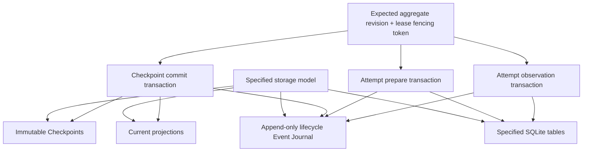

# Durable State

## Purpose

Durable State preserves the authoritative lifecycle of a Loop independently of any Runtime Session, runner conversation, or telemetry backend. Phase One combines current projections, immutable Checkpoints, and an append-only lifecycle Event Journal in SQLite; it does not reconstruct authority by replaying a fully event-sourced history. Every durable transition is guarded by optimistic concurrency and lease fencing, while external effects are separated from database transactions by a prepare/effect/observation protocol. Recovery begins from the latest valid Checkpoint and durable execution records, then reconciles any work whose external outcome is uncertain.

## Position in the System

The [Core Domain](core-domain.md) defines the versioned `Checkpoint`, aggregate revision, lifecycle entities, resource references, verification state, and pure transition invariants that the store persists. The [Runtime Lifecycle](runtime-lifecycle.md) supplies the Checkpoint Manager and Recovery Manager: the former validates authoritative mutations and commits them atomically, while the latter acquires a lease, loads durable state, and reconciles interrupted work.

[Work Unit Execution](work-unit-execution.md) records Attempt intent before invoking a runner and stores opaque external execution references without importing the runner's state machine. [Verification and Recovery](verification-recovery.md) supplies versioned findings and exact target bindings that must be validated before a Checkpoint can accept work. [Context Management](context-management.md) contributes immutable, digest-bound Boot Packages and resources; unfinalized resources cannot enter a Checkpoint.

`loopward-store-sqlite` is the Phase One adapter for the storage ports owned by `loopward-runtime`. It depends inward on `loopward-core` and `loopward-runtime`, and owns transactions, projections, immutable Checkpoints, the Event Journal, leases, fencing, schema migrations, and resource metadata. Large resource bodies remain outside SQLite. [Observability](observability.md) may receive trace and span identifiers recorded alongside durable events, but telemetry is never an authority for recovery.

## Architecture

The diagram is a conceptual view of the specified storage model and atomic write
sets. Arrows show participation or reference relationships, not exact database
cardinality or a physical schema.

The current projection is the query-efficient view of the Loop's latest lifecycle state. `aggregate_revision` increments on every durable lifecycle transition, while `checkpoint_version` increments only when an authoritative Checkpoint is committed. Every write supplies an expected aggregate revision and the current lease fencing token. A stale revision loses an optimistic-concurrency race; a stale fencing token cannot write even if its former holder resumes.

A Checkpoint is a versioned authoritative snapshot rather than a conversation summary or necessarily a success point. Its identity contains the Loop, Checkpoint, parent, version, aggregate revision, and creation time. Its body carries kernel status, goal and success criteria, losslessly pinned constraints and policies, work state, observations, decisions, domain state, resources, verification, continuation, telemetry summary, and integrity. The stored serialized bytes are hashed with SHA-256; Phase One does not require cross-language canonical JSON.

Checkpoint rows are immutable. Committing a new version updates the current Loop projection and associated lifecycle records in the same SQLite transaction; an existing version is not rewritten. A Checkpoint may safely represent accepted progress, pending verification, remediation, suspension, a failed or ambiguous Attempt, a recovery finding, completion, or failure.

The Event Journal is an append-only record of durable lifecycle facts, including Loop and Episode creation, context hydration, Session and Attempt transitions, verification completion, Checkpoint commitment, and Loop suspension, resumption, or completion. Each event carries its per-Loop sequence position, aggregate revision, schema version, timestamps, and trace/span identifiers when available. It complements projections and Checkpoints but is not a full event-sourcing log: recovery does not depend on replaying all historical events.

The SQLite store includes `loops`, `loop_leases`, `operations`, `command_idempotency`, `checkpoints`, `episodes`, `runtime_sessions`, `work_units`, `work_unit_attempts`, `verification_runs`, `suspensions`, `resources`, `resource_edges`, `loop_events`, and `schema_migrations`. Lifecycle query fields use typed columns, while domain state and versioned event payloads use JSON. Resource metadata and graph edges are durable, but large resource contents are stored externally.

## Runtime Flows

1. **Prepare, perform, and observe an external effect.**
   1. The runtime validates the Work Unit operation and opens a prepare transaction using the expected aggregate revision and current lease fencing token.
   2. The transaction records a durable `WorkUnitAttempt` identity, stable idempotency key, `PREPARED` status, `attempt.prepared` event, and incremented aggregate revision.
   3. After the prepare transaction commits, the runtime calls the runner outside the SQLite transaction, passing the Attempt ID, idempotency key, trace context, and bounded request.
   4. On success, an observation transaction records `RUNNING`, the opaque external execution reference, the capability snapshot, `attempt.started`, and another incremented aggregate revision.
   5. If the process fails between the external call and observation commit, recovery reconciles by Attempt ID and idempotency key. It does not infer that the runner was never called.
   6. If reconciliation cannot establish whether an unsafe side effect occurred, the Attempt becomes `AMBIGUOUS` and the Loop is suspended.

2. **Commit one authoritative Checkpoint atomically.**
   1. The Checkpoint Manager validates the expected aggregate revision, expected Checkpoint version, and lease fencing token.
   2. It validates the Checkpoint and domain schemas, all referenced resource digests, pinned-state preservation, decision-proposal status, verification evidence, and continuation validity.
   3. One SQLite transaction inserts the immutable Checkpoint and writes the current Loop projection, Work Unit mutations, Episode terminal state, applicable Session terminal state, verification state, resource edges, and `checkpoint.committed` event.
   4. That transaction increments both the aggregate revision and Checkpoint version and stores the SHA-256 digest of the serialized Checkpoint bytes.
   5. Commit failure rolls the transaction back as a unit, leaving the prior Checkpoint authoritative; partial Checkpoint commits are forbidden.

3. **Acquire, renew, lose, and reacquire a Loop lease.**
   1. A runtime instance acquires the Loop's lease and receives the current monotonically increasing fencing token.
   2. Every durable write presents that token in addition to its expected aggregate revision.
   3. The driver renews the lease while long external operations run outside database transactions.
   4. Lease loss immediately prevents local commits and starts reconciliation; it does not prove that an external runner stopped and does not trigger blind cancellation.
   5. Reacquisition increments the fencing token. A paused former holder is fenced out when it later attempts a write with its stale token.

4. **Recover from the latest durable boundary.**
   1. Recovery acquires the lease, loads the latest committed Checkpoint and journal position, and replays only durable events after that Checkpoint.
   2. It inspects the active Attempt and durable intent, validates relevant resource integrity, and chooses an evidence-based action.
   3. Intent recorded before any call permits start with the same idempotency key; a prepared or uncertain start requires reconciliation; a recorded running handle permits runner status lookup or reattachment.
   4. A stored result resumes validation or verification against the same target digest. Accepted verification with a missing Checkpoint resumes the commit using the expected revision.
   5. A committed Checkpoint means the next Episode can begin even if the prior process crashed before trace export, because telemetry is non-authoritative.
   6. Ambiguous unsafe effects suspend rather than repeat; changed verification targets become stale and are re-evaluated.

The specified crash outcomes are:

| Crash point | Durable recovery action |
|---|---|
| Before runner start | Restart or abort safely |
| After Attempt prepared | Reconcile by idempotency key |
| After start, before external reference persisted | Reconcile; suspend if ambiguity remains |
| While runner is running | Query the runner using the external reference |
| After result stored, before Checkpoint | Validate the stored result and resume commit |
| During the Checkpoint transaction | Rely on SQLite rollback; retain the prior Checkpoint |
| After Checkpoint, before trace export | Continue; telemetry is non-authoritative |
| During Session drain | Close the failed Session and preserve a valid handoff |
| During verification | Restart against the same target digest |

## Key Decisions

### Use SQLite for the Phase One durable store

- **Decision:** `loopward-store-sqlite` provides Phase One transactions, projections, immutable Checkpoints, journal, leases, fencing, migrations, and resource metadata.
- **Rationale:** No PR or design doc records a rationale; observed current state: the storage model combines current projections, immutable Checkpoints, and an append-only lifecycle Event Journal, and the architecture assigns durable storage responsibilities to `loopward-store-sqlite`.
- **Consequences:** Phase One has a concrete adapter for the specified projections, immutable Checkpoints, lifecycle journal, transactions, leases and fencing, migrations, and resource metadata.
- **Ref:** `docs/01-system-architecture.md` (section 3: Crate Responsibilities); `docs/03-durable-state-and-transactions.md` (section 1: Storage Model).

### Keep Checkpoint versions immutable

- **Decision:** A Checkpoint commit inserts a new monotonically increasing version and never mutates an earlier Checkpoint.
- **Rationale:** No PR or design doc records a rationale; observed current state: the storage model specifies immutable Checkpoints, and recovery is defined to begin from the latest valid committed version.
- **Consequences:** Failed transactions leave the previous snapshot authoritative, historical recovery boundaries remain inspectable, and Checkpoint version changes remain distinct from other aggregate revisions.
- **Ref:** `docs/00-project-charter.md` (sections 3 and 8: Goals; Foundational Principles); `docs/03-durable-state-and-transactions.md` (sections 1, 2, 5, and 10: Storage Model; Versioning; Checkpoint Commit; Storage Invariants).

### Persist intent before invoking an external effect

- **Decision:** Every side-effecting runner operation commits stable intent and idempotency identity before performing the external call, then commits the observed outcome separately.
- **Rationale:** No PR or design doc records a rationale; observed current state: the specifications require recovery to distinguish an uncalled operation from an uncertain external start and to reconcile uncertain effects rather than blindly repeat them.
- **Consequences:** External calls never run inside a database transaction, retries reuse stable identity where specified, and unknown unsafe effects become ambiguous suspension states.
- **Ref:** `docs/00-project-charter.md` (section 8: Foundational Principles); `docs/03-durable-state-and-transactions.md` (sections 4 and 9: Intent-Before-Effect; Crash Recovery Matrix); `docs/06-verification-and-recovery.md` (sections 12 and 13: Recovery Model; Recovery Decisions).

### Combine optimistic concurrency with lease fencing

- **Decision:** Every write validates both an expected aggregate revision and the active Loop lease's fencing token.
- **Rationale:** No PR or design doc records a rationale; observed current state: the storage specification requires at most one driver to mutate a Loop and explicitly prevents a stale resumed driver from committing after lease reacquisition.
- **Consequences:** Revision conflicts reject writes based on stale state, fencing rejects writes from stale ownership, and lease loss shifts the runtime into reconciliation without asserting control over the runner.
- **Ref:** `docs/03-durable-state-and-transactions.md` (sections 2 and 7: Versioning; Lease and Fencing).

### Keep conversations and telemetry outside authoritative recovery state

- **Decision:** Recovery uses committed Checkpoints, durable execution records, and journal position rather than prior runner conversation or trace storage.
- **Rationale:** No PR or design doc records a rationale; observed current state: the charter declares conversation non-authoritative, while the recovery specification makes trace data optional and starts from durable state.
- **Consequences:** Session replacement and telemetry-export failure cannot erase accepted work; context can be reconstructed from durable resources, and traces remain diagnostic rather than transactional.
- **Ref:** `docs/00-project-charter.md` (sections 3 and 8: Goals; Foundational Principles); `docs/03-durable-state-and-transactions.md` (sections 1, 6, and 9: Storage Model; Event Journal; Crash Recovery Matrix); `docs/06-verification-and-recovery.md` (section 12: Recovery Model).

## Implementation Notes

- **Invariant:** `aggregate_revision` increases on every durable lifecycle transition; `checkpoint_version` increases only on authoritative Checkpoint commit.
- **Invariant:** Checkpoint versions, aggregate revisions, and committed per-Loop event positions increase monotonically.
- **Invariant:** Event sequence is gap-free per committed transaction, and journal entries remain transactionally consistent with projection changes.
- **Invariant:** At most one driver may mutate a Loop, and a stale fencing token cannot write.
- **Invariant:** At most one Episode is active per Loop in Phase One.
- **Invariant:** Closed Sessions cannot reopen.
- **Invariant:** Unfinalized resources cannot enter a Checkpoint; evidence resources must be immutable, version-addressed, or content-addressed.
- **Invariant:** Runner results and proposed decisions are not authoritative until validation, verification, and the applicable decision or Checkpoint gate accepts them.
- **Invariant:** External work occurs outside SQLite transactions.
- **Invariant:** Recovery does not equate a missing result with a failed external operation.
- **Persistence boundary:** Typed columns store lifecycle query fields; JSON stores schema-declared domain state and versioned event payloads; large resource contents remain outside SQLite.
- **Journal boundary:** High-volume progress stays in tracing or logs unless it materially affects recovery or user decisions.
- **Integrity boundary:** The Checkpoint digest is `SHA-256(stored serialized Checkpoint bytes)`; canonical JSON across languages is not required in Phase One.
- **Configuration:** Phase One defaults to WAL mode, `foreign_keys = ON`, a configured `busy_timeout`, `synchronous = NORMAL`, and transactional migrations.
- **Optional durability:** A high-durability deployment may choose `synchronous = FULL`.
- **Specification status:** The durable-state documents are drafts for review; implementation has not been assessed.

## Spec Deviations

### PR #3's "validate invariants on append, not only on checkpoint commit" fix is a real but narrower-than-§10 defense-in-depth addition

- **Expected:** `docs/03-durable-state-and-transactions.md` §10 (Storage Invariants) lists eight invariants a durable write must not violate, including "one Loop has at most one active Episode," "closed Sessions cannot reopen," and "unfinalized resources cannot enter a Checkpoint." Nothing in §10 or §5 scopes these checks to Checkpoint commit only.
- **Implemented:** Before PR #3, `SqliteLoopStore`'s `append_in_transaction` (`crates/loopward-store-sqlite/src/store.rs`) folded each `LoopEvent` through `evolve` and persisted the resulting projection with no independent check that the folded state was internally consistent; `commit_in_transaction` (`crates/loopward-store-sqlite/src/checkpoint.rs`) was the only store-layer path that rejected an inconsistent write, and only for the invariants its own `validated_state`, `write_episode`, and `write_session` helpers happen to check. PR #3 added a call to `loopward_core::validate_invariants` in `append_in_transaction`, right before `write_projection_row`, mapping a failure to `SqliteStoreError::EventDidNotApply`. `validate_invariants` (`crates/loopward-core/src/invariants.rs`) checks the cross-entity structural invariants of `docs/02-core-domain-model.md` §2 — including "at most one active Episode" and "at most one active Work Unit" — against a single in-memory `AggregateState` snapshot. It does not, and structurally cannot from one snapshot, enforce "closed Sessions cannot reopen": that check (`write_session`'s `SqliteStoreError::ClosedSessionReopened`) compares the incoming status against the *previously stored* row for that Session, and only `commit_in_transaction` performs it, because only `commit_in_transaction` writes to the typed `episodes`/`runtime_sessions`/`work_units`/`work_unit_attempts` tables `append` never touches. Likewise "unfinalized resources cannot enter a Checkpoint" is enforced solely by `write_resource_edges`, which `append` never calls, and "Checkpoint versions increase monotonically" is a `commit_in_transaction`-only check (`validated_state`'s `SqliteStoreError::NonMonotonicCheckpointVersion`) that has no meaning for `append`, which never advances `checkpoint_version`.
- **Reason:** PR #3's body, commit list item 5, describes the fix as "defense-in-depth invariant check before persisting the projection," matching the in-code comment on the new call: a `decide`/`evolve` bug that produces an invariant-violating state "must not be silently persisted just because no Checkpoint happened to commit while it was visible." No design doc or PR body claims this closes every §10 gap between `append` and `commit_checkpoint` — only the cross-entity structural ones `validate_invariants` checks.
- **Impact:** The fix is real: `append` now independently rejects a subset of invariant-violating states (active-Episode/Work-Unit consistency, entity-loop ownership, Session/Attempt/Checkpoint cross-field consistency) that it previously would have persisted unchecked. But every current caller of `append` already calls the identical `decide → evolve → validate_invariants` sequence before invoking it — `LoopController::apply` (`crates/loopward-runtime/src/controller/advance.rs`) is the one production call site, and `loopward-testkit`'s `FailureInjector::step` (`crates/loopward-testkit/src/failure.rs`) mirrors it verbatim for tests — so no known caller today reaches `append` with a state that has not already passed `validate_invariants` once. The store-layer check is a second, independent line of defense against a future caller or a `decide`/`evolve` regression, not a fix for a currently reachable gap; no regression test in `crates/loopward-store-sqlite/tests/transaction_contract.rs` exercises the new check's rejection branch. Separately, "closed Sessions cannot reopen," "unfinalized resources cannot enter a Checkpoint," and "Checkpoint versions increase monotonically" remain enforced only inside `commit_in_transaction`, unaffected by this fix, because `append` never writes the rows those checks read.
- **Status:** resolved for the cross-entity structural invariants `validate_invariants` checks; the remaining §10 invariants that require comparing against previously stored rows or that describe Checkpoint-only state stay commit-time-only by design, not by omission.

## Source Anchors

### Specification Sources

- `docs/00-project-charter.md` (sections 3, 5, and 8: Goals; Framework Boundaries; Foundational Principles)
- `docs/01-system-architecture.md` (sections 3, 5, and 6: Crate Responsibilities; Controller Components; Primary Execution Flow)
- `docs/02-core-domain-model.md` (sections 7–11: Checkpoint through Domain State)
- `docs/03-durable-state-and-transactions.md` (sections 1–10: Storage Model through Storage Invariants)
- `docs/06-verification-and-recovery.md` (sections 12–14: Recovery Model through Checkpoint Safety)
- `docs/schemas/checkpoint-v0.1.yaml` (Checkpoint wire example)
- `docs/schemas/event-v0.1.yaml` (durable event wire example)

### Implementation Sources

- `crates/loopward-store-sqlite/src/lib.rs` (module: SqliteLoopStore, FileResourceBroker, SqliteStoreConfig, Synchronous, CHECKPOINT_SCHEMA_VERSION, WORK_UNIT_SCHEMA_VERSION, MIGRATOR, run_migrations)
- `crates/loopward-store-sqlite/src/store.rs` (module: SqliteLoopStore's LoopStore implementation covering load, append, commit_checkpoint, acquire_lease, and renew_lease; append_in_transaction's validate_invariants call, write_projection_row, and finish)
- `crates/loopward-store-sqlite/src/checkpoint.rs` (module: commit_in_transaction, validated_state, write_lifecycle, write_episode, write_session, write_work_unit, write_attempt, write_resource_edges, and insert_checkpoint)
- `crates/loopward-store-sqlite/src/event.rs` (module: max_sequence, insert, and read_all for the loop_events journal)
- `crates/loopward-store-sqlite/src/lease.rs` (module: current_fencing_token, acquire_in_transaction, and renew_in_transaction)
- `crates/loopward-store-sqlite/src/resource.rs` (module: FileResourceBroker's ResourceBroker implementation covering begin, write, finalize, recover_published_digest, and resolve)
- `crates/loopward-store-sqlite/src/error.rs` (module: SqliteStoreError, its port conversions, and the storage-invariant variants with no dedicated port error)
- `crates/loopward-store-sqlite/migrations/0001_initial.sql` (schema: loops, loop_events, loop_leases, operations, command_idempotency, checkpoints, episodes, runtime_sessions, work_units, work_unit_attempts, verification_runs, suspensions, resources, resource_edges, and schema_migrations)
- `crates/loopward-store-sqlite/tests/transaction_contract.rs` (referenced not owned: the fencing, revision-conflict, and projection-folding contract tests append and commit_checkpoint must satisfy)
- `crates/loopward-store-sqlite/tests/schema_version_pinning.rs` (referenced not owned: the field-set pinning tests tying CHECKPOINT_SCHEMA_VERSION and WORK_UNIT_SCHEMA_VERSION to their struct shapes)
- `crates/loopward-core/src/invariants.rs` (referenced not owned: validate_invariants, the cross-entity structural invariant checker append_in_transaction calls directly and commit_in_transaction's runtime-layer callers call before every commit)

## Related Pages

- [Public API](public-api.md)
- [Core Domain](core-domain.md)
- [Runtime Lifecycle](runtime-lifecycle.md)
- [Context Management](context-management.md)
- [Work Unit Execution](work-unit-execution.md)
- [Verification and Recovery](verification-recovery.md)
- [Observability](observability.md)
- [CLI and Testkit](cli-and-testkit.md)
