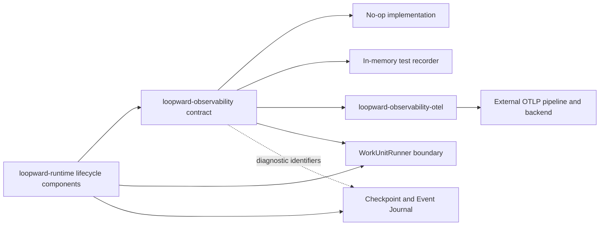

# Observability

## Purpose

Observability explains Loopward's lifecycle decisions and correlates them with runner-owned execution without making telemetry part of authoritative state. One bounded top-level trace represents each Episode, and links connect consecutive Episodes across committed Checkpoints. Loopward instruments its public execution boundary even when a runner exposes no internal telemetry, while propagation and opaque trace references enable stronger correlation when supported. Tracing remains best-effort by default: Loop progress and recovery continue from durable state when telemetry is disabled or degraded.

## Position in the System

`loopward-observability` defines the backend-neutral telemetry contract used by [Runtime Lifecycle](runtime-lifecycle.md) and its Context, Session, Work Unit, Verification, Checkpoint, Recovery, Resource, and Budget components. It owns semantic convention names, trace-completeness types, a telemetry facade, a no-op implementation, and a test recorder. The runtime depends only on that contract, not on an exporter or observability product.

`loopward-observability-otel` is an outward-pointing adapter that depends on `loopward-observability`. It supplies W3C Trace Context propagation, optional OTLP exporter configuration, Episode traces and span links, a Rust `tracing` bridge, bounded flush, and degradation reporting. [CLI and Testkit](cli-and-testkit.md) composes the optional adapter and validates instrumentation with in-memory recording; telemetry storage, querying, visualization, alerting, and Web UI remain external deployment concerns.

[Work Unit Execution](work-unit-execution.md) carries trace context to runners and records their actual coordination capability. [Durable State](durable-state.md) may store trace and span identifiers with lifecycle events, but Checkpoints, the Event Journal, and resource integrity—not traces—remain authoritative for recovery. The public trace carrier and opaque external trace references belong to [Public API](public-api.md).

## Architecture



The facade exposes stable, backend-neutral lifecycle instrumentation. Stable span names are low-cardinality constants:

```text
loopward.episode
loopward.context.hydrate
loopward.session.start
loopward.session.run
loopward.session.drain
loopward.session.close
loopward.work_unit.execute
loopward.work_unit.collect
loopward.verification.evaluate
loopward.checkpoint.commit
loopward.recovery.reconcile
loopward.resource.resolve
```

Identifiers belong in span attributes rather than span names. Applicable lifecycle attributes include Loop, Episode, Session, Work Unit, Attempt, runner, Checkpoint, phase, operation, and outcome fields. Conditional attributes record rotation, suspension, failure, recovery, context-estimation, and verification details. High-cardinality identifiers may support trace correlation but must not automatically become metric labels.

Each Episode owns one top-level `loopward.episode` trace. Its root span links to the previous Episode trace and records the Checkpoint used for hydration. Causal relations that are not parent-child containment use links such as `continuation_of`, `retry_of`, `recovery_of`, `remediation_of`, and `external_execution`. Runner-provided trace references remain opaque: Loopward links or records them without claiming ownership of the runner's spans.

`TraceContext` on `WorkUnitRequest` carries optional `traceparent`, optional `tracestate`, and allow-listed baggage. Sensitive Loop state, prompt content, credentials, and unrestricted identifiers must not cross the runner boundary as baggage. The observed coordination level is one of `BoundaryOnly`, `Correlated`, or `Continuous`, reflecting whether the runner only has a Loopward boundary span, returns an external reference, or accepts compatible propagated context.

Events, metrics, and logs are complementary views of lifecycle telemetry. Significant trace events may duplicate durable facts for diagnosis, but the Event Journal remains authoritative. Metrics are derived with low-cardinality labels. Structured logs include trace and span identifiers when available and exclude full prompts, Boot Packages, credentials, unrestricted resources, and raw user data by default.

## Runtime Flows

1. **Create an Episode trace and link durable continuation.**
   1. When the Loop Controller begins an Episode, the telemetry facade starts a bounded `loopward.episode` root span with applicable Loop and Episode identifiers.
   2. If a prior Episode exists, the new root adds a `continuation_of` link to its trace and records the committed Checkpoint reference used for hydration.
   3. Context hydration, Session lifecycle, Work Unit execution, verification, resource access, recovery, and Checkpoint commit create stable named child spans at their Loopward-owned boundaries.
   4. Business outcomes are recorded separately from telemetry status. Suspension can be a successful span with `loopward.outcome=suspended`, while a runner protocol failure records an error status and typed public failure code.
   5. The committed Checkpoint terminates the Episode and therefore the trace. A following Episode begins a new trace rather than extending an indefinitely open trace.

2. **Propagate and correlate a runner execution.**
   1. The Work Unit Manager opens `loopward.work_unit.execute` for every runner call, regardless of runner telemetry capability.
   2. It injects W3C `traceparent`, `tracestate`, and only allow-listed baggage into the `WorkUnitRequest`.
   3. A runner that cannot propagate context yields `BoundaryOnly`; a runner returning opaque trace references yields `Correlated`; a compatible runner accepting context and emitting child or linked spans yields `Continuous`.
   4. Loopward records the capability actually observed and adds `external_execution` links or references without importing the external trace topology.
   5. Cancellation telemetry records whether cancellation was requested, acknowledged, and observed; raw sensitive error content is replaced by public codes and sanitized descriptions.

3. **Emit diagnostic signals without changing durable authority.**
   1. Lifecycle spans attach events such as `rotation.requested`, `runner.compaction.reported`, `verification.finding`, `checkpoint.committed`, `execution.suspended`, and `recovery.ambiguity_detected`.
   2. Facts needed for recovery are recorded in the durable Event Journal when required for recovery. The trace event is only a diagnostic copy.
   3. Low-cardinality metrics may be derived for Episodes, Attempts, rotations, Checkpoint commits, verification, recovery, context tokens, and durations. Entity identifiers are excluded from default metric labels.
   4. Structured logs may carry trace and span identifiers but apply the same redaction boundary as traces and baggage.

4. **Flush within bounds and degrade safely.**
   1. When configured, the OpenTelemetry adapter exports through the deployment-supplied OTLP endpoint and performs only bounded flush work.
   2. Exporter failure or telemetry loss is reported as telemetry degradation and does not corrupt Checkpoints, journal entries, or resources.
   3. Under the default best-effort policy, the runtime continues from `Checkpoint + Event Journal + resource integrity`; it does not attempt trace reconstruction.
   4. If deployment policy explicitly requires audit delivery, that policy may make delivery failure significant; the core observability contract itself does not impose this requirement.
   5. With tracing disabled, the no-op implementation preserves runtime behavior and all durable recovery guarantees without a telemetry backend or UI.

## Key Decisions

### Keep the runtime contract backend-neutral

- **Decision:** `loopward-runtime` depends on `loopward-observability`, while exporter and backend choices remain outside the lifecycle engine.
- **Rationale:** No PR or design doc records a rationale; observed current state: the architecture assigns semantic conventions, trace-completeness types, a facade, no-op implementation, and test recorder to a backend-neutral crate.
- **Consequences:** Lifecycle instrumentation can be tested without external services, deployments can select telemetry infrastructure independently, and the runtime can operate with tracing disabled.
- **Ref:** `docs/01-system-architecture.md` (sections 3 and 4: Crate Responsibilities; Dependency Rules); `docs/08-tracing-and-observability.md` (sections 2, 3, and 14: Boundary; Backend Independence; Testability).

### Isolate OpenTelemetry in an outward adapter

- **Decision:** W3C propagation, OTLP configuration, Rust `tracing` bridging, Episode links, bounded flush, and degradation reporting belong to `loopward-observability-otel`.
- **Rationale:** No PR or design doc records a rationale; observed current state: Phase One chooses OpenTelemetry-compatible tracing while forbidding OpenTelemetry dependencies in Core and assigning the SDK integration to a dedicated adapter.
- **Consequences:** Core and runtime contracts remain independent of the SDK, and OTLP configuration is supplied by deployment rather than embedded in framework policy.
- **Ref:** `docs/00-project-charter.md` (section 7: Technology Baseline); `docs/01-system-architecture.md` (sections 3 and 4: Crate Responsibilities; Dependency Rules); `docs/08-tracing-and-observability.md` (section 3: Backend Independence).

### Segment traces at Episode boundaries

- **Decision:** One Episode is one top-level trace, with consecutive Episode roots linked across committed Checkpoints.
- **Rationale:** The tracing specification states that this avoids indefinitely open traces, aligns trace size with bounded progress, survives telemetry loss, permits Episode-level retention and sampling, and matches rotation and recovery boundaries.
- **Consequences:** A Loop is observed as a linked trace sequence; the Checkpoint is both the durable continuation boundary and trace segmentation boundary.
- **Ref:** `docs/07-session-rotation.md` (section 13: Episode and Trace Segmentation); `docs/08-tracing-and-observability.md` (section 4: Trace Segmentation); `docs/10-mvp-and-evaluation.md` (sections 2 and 10: Hypotheses; Success Metrics).

### Keep telemetry non-authoritative by default

- **Decision:** Recovery uses Checkpoints, the Event Journal, and resource integrity rather than trace reconstruction, and telemetry loss does not stop Loop progress unless deployment policy explicitly requires audit delivery.
- **Rationale:** The specifications require recovery from process, runner, Session, and telemetry failures while excluding a built-in trace backend from Phase One.
- **Consequences:** Export failure after Checkpoint commit cannot erase accepted work; operators may lose diagnostic detail, but durable lifecycle correctness remains intact.
- **Ref:** `docs/00-project-charter.md` (sections 3 and 4: Goals; Non-Goals); `docs/08-tracing-and-observability.md` (section 13: Sampling and Reliability); `docs/10-mvp-and-evaluation.md` (sections 8 and 13: Failure Injection Matrix; Phase One Acceptance Gates).

### Keep telemetry storage and presentation external

- **Decision:** Loopward does not ship telemetry storage, querying, visualization, alerting, dashboards, or a Web UI.
- **Rationale:** No PR or design doc records a rationale; observed current state: the charter and tracing boundary explicitly place those capabilities outside Phase One and outside `loopward-observability-otel`.
- **Consequences:** Deployments must provide any desired backend and operator interface; Loopward remains usable without either.
- **Ref:** `docs/00-project-charter.md` (section 4: Non-Goals); `docs/01-system-architecture.md` (section 3: Crate Responsibilities); `docs/08-tracing-and-observability.md` (sections 2, 3, and 15: Boundary; Backend Independence; Acceptance Criteria).

## Implementation Notes

- **Invariant:** Every Episode produces one bounded top-level trace when tracing is enabled; a Loop is never modeled as one indefinitely open trace.
- **Invariant:** Every runner invocation has a Loopward-owned boundary span, even when the runner propagates no trace context.
- **Invariant:** Recorded runner coordination level reflects actual capability: `BoundaryOnly`, `Correlated`, or `Continuous`.
- **Invariant:** The root of each subsequent Episode links to its predecessor and records the Checkpoint used for hydration.
- **Invariant:** Trace events are diagnostic copies; the durable Event Journal remains authoritative for recovery-relevant facts.
- **Invariant:** Business outcome and telemetry status are distinct.
- **Privacy boundary:** Baggage is allow-listed and excludes sensitive Loop state, prompts, credentials, and unrestricted identifiers.
- **Redaction boundary:** Traces and logs exclude full prompts, full Boot Packages, credentials, unrestricted resource contents, and raw user data by default.
- **Metric boundary:** Loop, Episode, Session, Work Unit, Attempt, and resource identifiers are not default metric labels.
- **Reliability boundary:** Flush is bounded, and telemetry loss cannot corrupt or block durable recovery under the default policy.
- **Configuration:** An enabled OTLP exporter receives its endpoint from deployment configuration such as `OTEL_EXPORTER_OTLP_ENDPOINT`; no local address or backend product is prescribed.
- **Sampling:** External policies should preserve errors, ambiguity, suspension, recovery, and rotation anomalies when supported.
- **Testing:** Phase One uses an in-memory span exporter or recorder, deterministic clocks and identifiers, assertions on names, attributes, links, and redaction, plus failure injection around runner, verification, and Checkpoint operations.
- **Evaluation:** Trace continuity is measured as Episodes correctly linked through Checkpoints; unavailable telemetry remains unavailable rather than estimated without attribution.
- **Specification status:** The observability documents are drafts for review; implementation has not been assessed.

## Spec Deviations

Implementation has not been assessed.

## Source Anchors

### Specification Sources

- `docs/00-project-charter.md` (sections 3, 4, and 7: Goals; Non-Goals; Technology Baseline)
- `docs/01-system-architecture.md` (sections 3 and 4: Crate Responsibilities; Dependency Rules)
- `docs/07-session-rotation.md` (sections 13 and 14: Episode and Trace Segmentation; Runtime API Semantics)
- `docs/08-tracing-and-observability.md` (sections 1–15: Purpose through Acceptance Criteria)
- `docs/10-mvp-and-evaluation.md` (sections 2, 8–10, and 13: Hypotheses; Failure Injection Matrix; Evaluation Layers; Success Metrics; Phase One Acceptance Gates)

### Implementation Sources

Implementation has not been assessed.

## Related Pages

- [Public API](public-api.md)
- [Core Domain](core-domain.md)
- [Runtime Lifecycle](runtime-lifecycle.md)
- [Context Management](context-management.md)
- [Work Unit Execution](work-unit-execution.md)
- [Durable State](durable-state.md)
- [Verification and Recovery](verification-recovery.md)
- [CLI and Testkit](cli-and-testkit.md)
