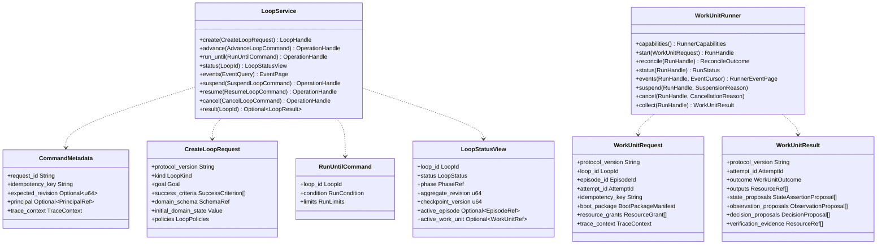

# Public API

## Purpose

The `loopward-api` crate defines Loopward's stable, language-neutral boundary for controlling durable Loop executions and delegating bounded Work Units to external runners. It gives callers finite, observable operations without exposing the Loop Controller, store, Runtime Session history, or domain-specific state as public implementation details. The same boundary allows external systems to wrap Loopward as a worker or to participate as a `WorkUnitRunner` while each system retains ownership of its authoritative state. These contracts are versioned independently so service, event, Checkpoint, Work Unit, Boot Package, and domain schemas can evolve without collapsing into one compatibility surface.

## Position in the System

`loopward-api` is the innermost public contract crate. The [Core Domain](core-domain.md) depends on it for typed identifiers and public contract types, while the [Runtime Lifecycle](runtime-lifecycle.md) implements `LoopService` and invokes explicitly supplied `WorkUnitRunner` implementations. The [Work Unit Execution](work-unit-execution.md) boundary carries runner requests, results, capabilities, events, cancellation, and suspension without granting runners access to the Loop store.

Adapters depend inward on these contracts. The command runner implements `WorkUnitRunner`, and the [CLI and Testkit](cli-and-testkit.md) uses the public runtime APIs as an ordinary client rather than as a privileged alternate state machine. External wrappers may translate between these contracts and another system's API, but opaque references prevent either framework's internal topology or state machine from leaking into the other.

## Architecture

`LoopService` is the inbound service boundary. Its mutating commands carry `CommandMetadata` for request correlation, scoped idempotency, optimistic concurrency, caller identity where deployed, and trace propagation. `create` validates schemas and policies before committing the initial Checkpoint; `advance` moves to the next safe durable boundary; and `run_until` requires at least one finite limit.

Read operations deliberately expose compact projections. `LoopStatusView` reports lifecycle status, revisions, active references, suspension, and terminal outcome without returning a complete Checkpoint, full event history, or sensitive resource contents. `EventQuery` pages through durable lifecycle events using monotonically ordered journal cursors and can separately request ephemeral runner progress, which may be sampled or unavailable later.

`WorkUnitRunner` is the outbound execution protocol. `RunnerCapabilities` declares optional behavior and is snapshotted per Attempt. `WorkUnitRequest` supplies explicit identifiers, a bounded Boot Package, resource grants, output contract, budget, deadline, and trace context rather than unrestricted store access. `WorkUnitResult` returns outputs and proposals; it has no authority to commit a Checkpoint, activate a decision, satisfy an acceptance criterion, or declare a Loop complete.

The error surface uses stable `LoopwardErrorCode` values with a sanitized message, retry guidance, and trace correlation where available. Public APIs additionally enforce authorization by Loop and operation, resource-grant scope, schema and input-size limits, redaction, administrative mutation auditing, and validation of untrusted runner output.

## Runtime Flows

1. **Create and begin a Loop.** A caller sends `CreateLoopRequest` with `CommandMetadata`, protocol version, goal, success criteria, constraints, domain schema and state, and policies. `LoopService::create` validates those schemas and policies before the runtime commits the initial Checkpoint and returns a `LoopHandle`. The caller then uses `LoopService::advance` for one safe durable step or `LoopService::run_until` with a `RunLimits` value containing at least one episode, deadline, or resource-cost bound.
2. **Observe and control execution.** A client calls `LoopService::status` for the compact `LoopStatusView` and `LoopService::events` with an `EventQuery` cursor for paged lifecycle history. It issues `LoopService::suspend`, `LoopService::resume`, or `LoopService::cancel` as explicit, idempotent, concurrency-aware commands, and later calls `LoopService::result` to collect an optional terminal `LoopResult`. Long-running mutations return `OperationHandle` rather than hiding unbounded coordinator work behind a request.
3. **Execute a Work Unit through a runner.** The runtime snapshots `WorkUnitRunner::capabilities`, durably records Attempt intent and its idempotency key, then calls `WorkUnitRunner::start` with a `WorkUnitRequest`. It may poll `status`, consume `events`, or request `suspend` or `cancel`; after interruption it uses `reconcile` when supported. Finally it calls `collect` for a `WorkUnitResult`, then validates and verifies the proposals before any accepted state reaches a Checkpoint.

## Key Decisions

### Keep public operations finite and observable

- **Decision:** `advance` ends at the next safe durable boundary, `run_until` requires an explicit finite limit, and longer work returns an `OperationHandle`.
- **Context:** A durable Loop may outlive any caller request or Runtime Session, so a public call cannot safely imply an unbounded coordinator session.
- **Alternatives rejected:** Concealing permanent or unlimited execution behind one service call is rejected because clients need explicit bounds, cancellation, status, and event observation.
- **Consequences:** Clients choose bounded progress and monitor operations through status or cursor-based events; at least one `RunLimits` bound is mandatory.
- **Ref:** `docs/09-public-api.md` (sections 2–4: Inbound Loop Service, Finite Operations, Command Metadata).

### Treat runner output as proposals

- **Decision:** `WorkUnitResult` may propose state, observations, decisions, evidence, and continuation, but only Loopward validation and verification can accept them.
- **Context:** Runner implementations may be agents, commands, services, human processes, or other frameworks and are outside lifecycle authority.
- **Alternatives rejected:** Allowing a runner to commit a Checkpoint, activate a decision, satisfy criteria, or declare completion is rejected because it bypasses durable transition and verification gates.
- **Consequences:** External execution remains replaceable, and runner completion stays distinct from result validation, verification, acceptance, Work Unit completion, and Loop completion.
- **Ref:** `docs/05-work-unit-and-runner-protocol.md` (section 7: Work Unit Result); `docs/02-core-domain-model.md` (sections 8 and 10: Observation and Decision; Acceptance and Verification).

### Version contracts independently

- **Decision:** Service protocol, Checkpoint schema, Work Unit protocol, Boot Package manifest, durable events, and domain state schema have independent versions.
- **Context:** These contracts evolve at different rates and cross process or persistence boundaries.
- **Alternatives rejected:** One implicit implementation version is rejected because it would couple unrelated compatibility surfaces and obscure migrations.
- **Consequences:** A Loop records versions at creation and migration, while callers and runners negotiate explicit protocol versions and receive typed `UnsupportedVersion` errors.
- **Ref:** `docs/09-public-api.md` (sections 10–11: Error Model; Versioning); `docs/schemas/checkpoint-v0.1.yaml` (field: `schema_version`); `docs/schemas/event-v0.1.yaml` (field: `schema_version`); `docs/schemas/work-unit-v0.1.yaml` (field: `schema_version`); `docs/schemas/work-unit-result-v0.1.yaml` (field: `schema_version`); `docs/schemas/boot-package-manifest-v0.1.yaml` (field: `schema_version`).

### Preserve state ownership across wrappers

- **Decision:** Cross-system execution references are opaque, and wrappers translate only public outcomes, control signals, and trace context.
- **Context:** Loopward may invoke an external system as a Work Unit or be invoked by one as a worker.
- **Alternatives rejected:** Copying internal state machines or introducing orchestration concepts into Loopward Core is rejected because each framework must remain authoritative for its own lifecycle.
- **Consequences:** External integrations can work in either direction without store access or topology leakage; Aether remains a possible future example, not a Phase One dependency.
- **Ref:** `docs/09-public-api.md` (section 13: Wrapper Integration); `docs/10-mvp-and-evaluation.md` (sections 3–4: Phase One Scope; Excluded Scope).

## Implementation Notes

- **Invariant:** Every mutating service command is idempotent within its documented scope and may carry `expected_revision` for optimistic concurrency.
- **Invariant:** The default status response excludes the full Checkpoint, complete event history, and sensitive resource contents.
- **Invariant:** A `WorkUnitRequest` grants only explicit resources and never direct access to the Loop store.
- **Invariant:** A retry creates a new durable Attempt; historical runner capabilities and prior Attempts are not overwritten.
- **Invariant:** Cancellation and suspension are cooperative unless a runner advertises stronger semantics; a timeout does not prove execution stopped.
- **Security constraint:** Administrative mutations require authorization and audit records, and public error messages and payloads must remain sanitized.
- **Open follow-up:** The exact administrative resource API is deferred. The specification lists possible Checkpoint metadata, integrity, lease, recovery, redacted Boot Package, resource metadata, and tracing-health views but does not define concrete operations or DTOs.
- **Phase One exclusion:** Aether, orchestration APIs, a distributed scheduler, an agent registry, and a production multi-tenant control plane are outside scope.

## Spec Deviations

Implementation has not been assessed.

## Source Anchors

### Specification Sources

- `docs/01-system-architecture.md` (sections 2–4: Workspace Layout; Crate Responsibilities; Dependency Rules)
- `docs/02-core-domain-model.md` (sections 2–10: LoopExecution through Acceptance and Verification)
- `docs/05-work-unit-and-runner-protocol.md` (sections 4–7 and 11–14: Runner Contract through Work Unit Result; Cancellation and Suspension through Acceptance Criteria)
- `docs/09-public-api.md` (sections 1–14: Purpose through Acceptance Criteria)
- `docs/10-mvp-and-evaluation.md` (sections 3, 11, and 13: Phase One Scope; CLI Surface; Phase One Acceptance Criteria)
- `docs/schemas/boot-package-manifest-v0.1.yaml` (field: schema_version; Boot Package manifest contract)
- `docs/schemas/checkpoint-v0.1.yaml` (field: schema_version; Checkpoint schema contract)
- `docs/schemas/event-v0.1.yaml` (field: schema_version; durable event schema contract)
- `docs/schemas/work-unit-result-v0.1.yaml` (field: schema_version; Work Unit result contract)
- `docs/schemas/work-unit-v0.1.yaml` (field: schema_version; Work Unit schema contract)

### Implementation Sources

Implementation has not been assessed.

## Related Pages

- [Core Domain](core-domain.md)
- [Runtime Lifecycle](runtime-lifecycle.md)
- [Work Unit Execution](work-unit-execution.md)
- [Durable State](durable-state.md)
- [Observability](observability.md)
- [CLI and Testkit](cli-and-testkit.md)
