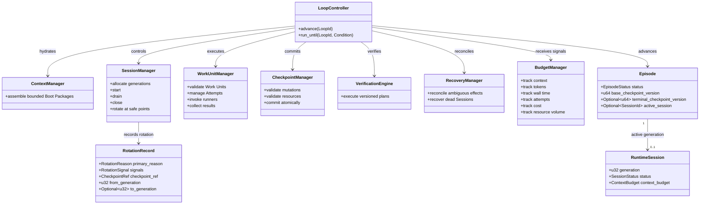

# Runtime Lifecycle

## Purpose

The `loopward-runtime` crate coordinates one bounded advance of a durable Loop from a committed Checkpoint to its next safe boundary. Its Loop Controller is the only component allowed to advance lifecycle state, while Session, context, execution, verification, recovery, budget, storage, and telemetry components provide structured inputs and effects. The runtime keeps `Episode`, `RuntimeSession`, and `WorkUnitAttempt` lifecycles distinct so that a runner result, Session closure, or budget signal cannot independently declare durable progress. Phase One defaults to a fresh Runtime Session for each Work Unit and makes every Episode terminate at a committed Checkpoint boundary.

## Position in the System

The runtime depends on stable identifiers and service contracts from the [Public API](public-api.md), pure lifecycle decisions and entities from the [Core Domain](core-domain.md), and backend-neutral instrumentation from [Observability](observability.md). It coordinates [Context Management](context-management.md), [Work Unit Execution](work-unit-execution.md), and [Verification and Recovery](verification-recovery.md) through runtime-owned managers and ports rather than concrete adapters.

The [Durable State](durable-state.md) adapter implements runtime storage ports for Checkpoints, events, attempts, leases, and recovery state. The [CLI and Testkit](cli-and-testkit.md) composes the runtime with concrete adapters and exercises bounded `advance` and `run_until` behavior. `loopward-runtime` must not depend on a concrete Store, runner, or telemetry exporter implementation.

## Architecture

The Loop Controller owns lifecycle advancement and selects transitions from structured durable state, effective policy, verification outcomes, observed results, and policy signals. An LLM may propose a plan or semantic judgment, but it cannot own lifecycle integrity. Runtime coordination remains deterministic wherever those inputs are sufficient.

An `Episode` is one attempt to move from a committed Checkpoint to the next durable semantic state. Its states progress through `Preparing`, `Hydrating`, `Executing`, `Draining`, and `Committing`, with recovery, suspension, and abortion paths. Every terminal Episode state either produces a committed Checkpoint or references an already committed terminal Checkpoint.

A `RuntimeSession` is a replaceable execution generation within an Episode. `SessionManager` allocates generations and manages creation, start, drain, close, and rotation safe points. Closed or failed generations are never reopened; continuation creates a new generation and hydrates it from durable state and resource references.

`BudgetManager` tracks context, model tokens, wall time, attempts, cost, and resource volume. It emits signals rather than lifecycle transitions. Soft context limits recommend rotation at the next safe boundary, while hard limits stop admission of additional model work and initiate drain; the Loop Controller remains responsible for selecting the resulting transition.

`RotationRecord` makes replacement explicit by retaining the primary reason, all contributing signals, the prior and next generations, the committed Checkpoint, the previous Boot Package manifest, the next context budget, and trace links. A Checkpoint is both the durable continuation boundary and the trace-segmentation boundary between Episodes.

## Runtime Flows

1. **Execute one primary Episode.** `advance(loop_id)` loads the current Checkpoint, and the Loop Controller selects a bounded `WorkUnit`. `ContextManager` assembles a Boot Package, `SessionManager` starts a fresh `RuntimeSession`, and `WorkUnitManager` persists Attempt intent before invoking the runner. The runtime collects a structured result, drains the Session, validates and verifies the result, commits the next Checkpoint through `CheckpointManager`, and closes the Episode. The controller then selects `continue`, `remediate`, `suspend`, `complete`, or `fail` from durable state; one call performs at most one durable Episode transition to a safe boundary.
2. **Rotate normally at a safe boundary.** A rotation signal causes the runtime to record rotation intent, stop admitting new work to the current Session, drain the runner, and collect a structured handoff. After validating the result, resources, and handoff, the runtime executes required verification and commits a Checkpoint. It closes the current Session generation, creates the next Episode and Session generation when continuation requires one, and hydrates a new Boot Package. If drain fails, the runtime records the failure and follows recovery policy instead of fabricating a successful handoff.
3. **Decide continuation after verification.** Runner completion yields a collected result, not authoritative acceptance. `VerificationEngine` applies the versioned Verification Plan and returns structured outcomes; the Loop Controller uses those outcomes with policy and durable state to decide whether the result is accepted, remediation is required, execution suspends, the Loop completes, or the Loop fails. A continuing Loop begins a new Episode from the committed terminal Checkpoint, and its top-level trace links to the prior Episode.
4. **Suspend during rotation.** Missing handoff data, ambiguous external execution, a pinned-constraint mismatch, an unavailable required resource, a request for human input, or a required policy decision can prevent safe continuation. The controller transitions the Episode to `Suspended`, commits the best-known durable state, and releases the execution lease when safe. Resume starts from that durable boundary rather than reopening a closed or failed Session generation.

## Key Decisions

### Give the Loop Controller exclusive lifecycle authority

- **Decision:** Only the Loop Controller may advance Loop lifecycle state; managers, runners, LLM outputs, verification results, and budget observations supply inputs but do not choose authoritative transitions.
- **Rationale:** No PR or design doc records a rationale; observed current state: the architecture names the Loop Controller as the only component allowed to advance lifecycle state and requires lifecycle decisions to remain deterministic wherever structured state, policy, verification, and observed results are sufficient.
- **Consequences:** Runner completion and semantic proposals cannot bypass validation or verification, and runtime integrations must report structured evidence and signals to the controller.
- **Ref:** `docs/01-system-architecture.md` (sections 1 and 5: Architectural Layers; Controller Components); `docs/02-core-domain-model.md` (section 12: Pure Transition Interface).

### Make every Episode terminate at a durable boundary

- **Decision:** Every terminal Episode state commits a Checkpoint or references an already committed terminal Checkpoint before another Episode begins.
- **Rationale:** No PR or design doc records a rationale; observed current state: the primary execution flow requires a Checkpoint before Episode closure, and the rotation specification defines the Checkpoint as both the durable continuation boundary and trace-segmentation boundary.
- **Consequences:** Continuation and recovery can proceed without Session history, and a long Loop is represented by trace-linked bounded Episodes rather than one indefinitely open execution or trace.
- **Ref:** `docs/01-system-architecture.md` (section 6: Primary Execution Flow); `docs/07-session-rotation.md` (sections 3, 13, and 14: Episode State Machine; Episode and Trace Segmentation; Runtime API Semantics).

### Default to a fresh Runtime Session per Work Unit

- **Decision:** Phase One starts a fresh Runtime Session for each Work Unit by default and treats Session reuse as an opt-in experiment.
- **Rationale:** No PR or design doc records a rationale; observed current state: Phase One policy requires deterministic rotation at Work Unit, verification, phase, context-integrity, and runner-failure boundaries while the evaluation compares this default with runner-managed continuous Sessions where available.
- **Consequences:** Each Work Unit receives bounded reconstructed context, closed and failed generations remain terminal, and evaluation must measure any rework or cost introduced by replacement.
- **Ref:** `docs/07-session-rotation.md` (sections 4, 8, and 15: Runtime Session State Machine; Phase One Policy; Acceptance Criteria); `docs/10-mvp-and-evaluation.md` (sections 6 and 13: Reference Scenario; Phase One Acceptance Gates).

### Keep budget management advisory to lifecycle policy

- **Decision:** `BudgetManager` emits policy signals, while the Loop Controller chooses whether and how the lifecycle transitions.
- **Rationale:** No PR or design doc records a rationale; observed current state: the controller component contract separates budget measurement from transition authority and assigns distinct safe-boundary semantics to soft and hard context limits.
- **Consequences:** A soft limit can defer rotation until current work reaches a safe boundary, a hard limit halts new model-work admission and initiates drain, and proxy measurements must retain their uncertainty when runner token usage is unavailable.
- **Ref:** `docs/01-system-architecture.md` (section 5: Controller Components); `docs/07-session-rotation.md` (sections 7, 8, and 10: Rotation Reasons; Phase One Policy; Budget Behavior).

### Bound public runtime execution

- **Decision:** `advance(loop_id)` performs at most one durable Episode transition, while `run_until(loop_id, condition)` repeats bounded advances only under explicit limits.
- **Rationale:** No PR or design doc records a rationale; observed current state: the runtime API specification rejects an unbounded hidden execution loop and requires deadlines, Episode limits, resource-cost limits, cancellation, or suspension conditions around repeated advancement.
- **Consequences:** Callers and the CLI can retain control over long-running execution, and cancellation, suspension, resource use, and progress boundaries remain observable.
- **Ref:** `docs/07-session-rotation.md` (section 14: Runtime API Semantics); `docs/10-mvp-and-evaluation.md` (section 11: CLI Surface).

## Implementation Notes

- **Invariant:** Phase One permits at most one active Episode and one active Work Unit per Loop.
- **Invariant:** Closed and failed Runtime Session generations never return to running; continuation allocates a new generation.
- **Invariant:** Every rotation records its primary reason, all contributing signals, and a Checkpoint reference.
- **Invariant:** Attempt success means a result was collected, not that the Work Unit or Loop was accepted.
- **Invariant:** A hard context limit stops admission of additional model work, requests drain, and leads to closure through controller-selected transitions.
- **Invariant:** Vendor compaction is recorded but is not a committed Checkpoint and does not make a compacted Session equivalent to a freshly hydrated Session.
- **Invariant:** `run_until` is bounded by explicit deadline, Episode, cost, cancellation, or suspension conditions.
- **Phase One constraint:** Runtime Session reuse is an opt-in evaluation experiment, not the default architecture.
- **Evaluation requirement:** The reference scenario rotates at every Work Unit boundary and includes deterministic rejection, remediation, process interruption, and a final completion gate.
- **Evaluation requirement:** Every Episode must be trace-linked to its predecessor, and runtime operation must remain valid with tracing disabled or without a telemetry backend.
- **Open follow-up:** Runner-specific token metrics may be unavailable; budget telemetry must distinguish reported values from conservative proxies and record estimation uncertainty.
- **Risk:** A drain or commit crash can leave external execution or durable acknowledgement ambiguous; the recovery path must reconcile the durable Checkpoint and external effect before retrying or continuing.

## Spec Deviations

Implementation has not been assessed.

## Source Anchors

### Specification Sources

- `docs/01-system-architecture.md` (sections 1, 3, 5, and 6: Architectural Layers; Crate Responsibilities; Controller Components; Primary Execution Flow)
- `docs/02-core-domain-model.md` (sections 2–7 and 12: LoopExecution through Checkpoint; Pure Transition Interface)
- `docs/07-session-rotation.md` (sections 1–15: Purpose through Acceptance Criteria)
- `docs/10-mvp-and-evaluation.md` (sections 5–7 and 11–13: Reference Architecture through Context Stress Scenario; CLI Surface through Phase One Acceptance Gates)

### Implementation Sources

Implementation has not been assessed.

## Related Pages

- [Public API](public-api.md)
- [Core Domain](core-domain.md)
- [Context Management](context-management.md)
- [Work Unit Execution](work-unit-execution.md)
- [Durable State](durable-state.md)
- [Verification and Recovery](verification-recovery.md)
- [Observability](observability.md)
- [CLI and Testkit](cli-and-testkit.md)
