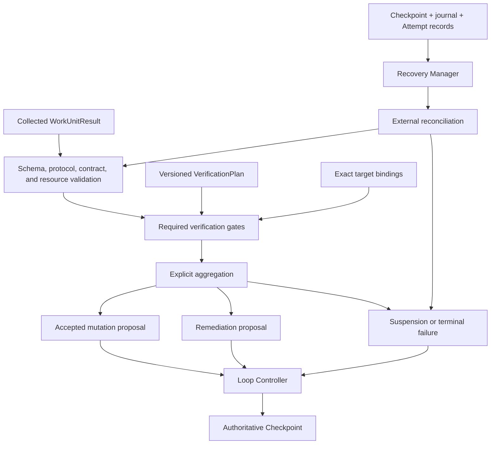

# Verification and Recovery

## Purpose

Verification and Recovery protects Loopward's authoritative state from unvalidated runner output, stale evidence, and uncertain external effects. It turns a structurally valid `WorkUnitResult` into accepted progress only after a predeclared, versioned `VerificationPlan` has passed against the exact target revision. It also resumes interrupted work from durable Checkpoints and journal records without depending on trace storage or runner conversation. When evidence is insufficient, the subsystem records rejection, inconclusive verification, suspension, remediation, or failure instead of inventing success.

## Position in the System

The [Work Unit Execution](work-unit-execution.md) boundary supplies the collected `WorkUnitResult`, finalized output resources, Attempt identity, idempotency key, and runner reconciliation capabilities. The result remains a proposal: runner-reported success cannot activate decisions, satisfy acceptance criteria, commit a Checkpoint, or complete the Loop.

The [Runtime Lifecycle](runtime-lifecycle.md) owns the `VerificationEngine` and `RecoveryManager`. The Verification Engine executes versioned plans while separating operation errors from criterion failures. The Recovery Manager loads durable state, reconciles external execution and ambiguous effects, validates resource integrity, and proposes the next safe action. The Loop Controller alone chooses and commits lifecycle transitions.

[Core Domain](core-domain.md) defines verification outcomes, findings, criteria, constraints, resources, Work Unit state, and completion invariants. [Durable State](durable-state.md) persists verification runs and findings, target bindings, Attempt observations, Checkpoints, journal events, revisions, leases, and fencing tokens. [Context Management](context-management.md) assembles bounded evidence for an agentic review without automatically carrying the implementation conversation. Human verification suspends the Loop with a structured request. [Observability](observability.md) may describe verification and recovery activity, but traces are not recovery authority.

## Architecture

The diagram shows the specified decision boundary. It is a conceptual model, not an implementation dependency graph.

A `VerificationPlan` exists before execution and is versioned. It binds a Work Unit to its output schema, applicable acceptance criteria, resource or workspace revisions, domain validation rules, aggregation policy, and remediation policy. A runner cannot weaken that plan through its result.

Verification gates are typed as schema, integrity, deterministic, policy, agentic, or human. The recommended order puts cheap and conclusive gates first: schema validation, digest and provenance integrity, deterministic checks, policy checks, bounded agentic semantic review, and required human approval. Phase One aggregation is explicit: every required gate must pass, no blocking finding may remain unresolved, and every target binding must still be current. Optional advisory gates may report findings, but those findings must be labeled non-blocking.

Each `VerificationFinding` records the gate, outcome, code, statement, evidence resources, and target digest. Findings bind to the resource digests, workspace or dataset revision, Work Unit result digest, verification-plan version, and applicable constraint digest that were evaluated. If any bound target changes, an earlier finding becomes stale; a stale pass cannot satisfy a criterion.

Agentic verification runs in a distinct bounded context containing the criteria, result, exact target revisions, applicable constraints, necessary evidence, and rubric. It does not automatically inherit the runner's implementation trajectory or conversation. Its judgment is proposal-generating unless domain policy explicitly grants it authority.

A human gate creates a structured `InputRequest` and suspends the Loop. Its response is evidence, and an approval records the principal, decision time, target digest, and scope. The specification leaves domain policy responsible for deciding where human authority is required.

Recovery begins from the latest committed Checkpoint and journal position. It inspects durable Attempt intent and observations, verifies resource integrity, and reconciles any external execution whose outcome is not established. Recovery may resume, collect, retry, suspend, or fail, but a missing local result is not proof that an external operation failed.

## Runtime Flows

1. **Validate, verify, and commit accepted progress.**
   1. `WorkUnitRunner.collect()` returns a versioned `WorkUnitResult`; runner success means only that a result was produced.
   2. Loopward validates the protocol version, Attempt identity, output contract, result schema, proposal fields, and every referenced resource's finalization and digest binding.
   3. The Verification Engine loads the predeclared `VerificationPlan` version and binds the run to the current result, resources, workspace or dataset revision, constraints, and acceptance criteria.
   4. Required gates run in the declared order. A gate execution problem is recorded as an operation error; a gate that executes and finds a criterion unsatisfied records a criterion failure.
   5. Every finding stores its evidence and exact target digest. Before aggregation, Loopward confirms that all target bindings remain current.
   6. The result becomes `ACCEPTED` only when every required gate passed, no blocking finding remains, and bindings are current.
   7. The Checkpoint Manager validates the accepted mutation and referenced resources. The Loop Controller then commits the authoritative Checkpoint using the expected aggregate revision; a runner or verifier cannot commit it directly.

2. **Remediate a rejected or inconclusive result.**
   1. A rejected or inconclusive verification produces durable findings rather than silently restarting the same Work Unit.
   2. The runtime creates a remediation proposal with lineage to those findings.
   3. Runtime policy selects a new Work Unit or a new explicitly related Attempt, bounded by retry and resource budgets.
   4. A phase or context-locality change creates a new Episode and fresh Runtime Session; the remediation receives updated evidence and constraints.
   5. The new result is validated and verified against the applicable plan and current target bindings.
   6. Repeated remediation without information gain triggers suspension or terminal failure according to policy.

3. **Recover and reconcile interrupted execution.**
   1. The Recovery Manager acquires the Loop lease, loads the latest committed Checkpoint and journal position, and replays only durable events after that boundary.
   2. It inspects the active Attempt, its recorded intent, idempotency key, external execution reference, stored result, verification state, and referenced resource integrity.
   3. Intent known not to have been sent may start with the same idempotency key. An uncertain start is reconciled rather than repeated.
   4. A runner-reported active execution is reattached; a completed execution is collected and validated; a stored result with incomplete verification resumes verification.
   5. Accepted verification with a missing Checkpoint resumes commit using the expected revision. A committed Checkpoint permits continuation from the next Episode.
   6. If an unsafe external effect remains ambiguous, the Attempt becomes ambiguous and the Loop suspends for policy or human resolution.
   7. If a verification target changed while execution was interrupted, prior findings become stale and verification runs again against the new target.

4. **Assess Loop completion and detect no progress.**
   1. Work Unit acceptance updates progress but does not by itself complete the Loop.
   2. The completion gate checks every required success criterion against current evidence, confirms no required Work Unit remains active, and rejects any unresolved blocking issue.
   3. It also requires applicable final verification, budget-policy permission, and agreement between authoritative state and referenced resources.
   4. The Loop Controller alone commits the terminal transition.
   5. Between accepted transitions, Phase One records repeated finding codes, result digests, target revisions, Work Unit objectives, Attempts without newly accepted evidence, and budget spent.
   6. Configured thresholds may suspend the Loop when those deterministic signals show no information gain; Phase One does not require a semantic stuck classifier.

## Key Decisions

### Let verification determine acceptance

- **Decision:** Runner-reported success and structurally valid output remain proposals until the predeclared verification plan accepts them against current evidence.
- **Rationale:** No PR or design doc records a rationale; observed current state: the runner owns execution while Loopward owns Work Unit lifecycle, verification status, Checkpoints, and terminal outcomes.
- **Consequences:** Only `ACCEPTED` results can produce accepted Work Unit mutations, and the Loop Controller remains the sole authority for Checkpoint and completion transitions.
- **Ref:** `docs/00-project-charter.md` (sections 5 and 8: Framework Boundaries; Foundational Principles); `docs/05-work-unit-and-runner-protocol.md` (section 7: Work Unit Result); `docs/06-verification-and-recovery.md` (sections 1, 2, and 16: Purpose; Result Lifecycle; Acceptance Criteria).

### Separate verification operation errors from criterion failures

- **Decision:** The Verification Engine distinguishes failure to execute a gate from a completed gate finding that a criterion was not satisfied.
- **Rationale:** No PR or design doc records a rationale; observed current state: the architecture explicitly requires the Verification Engine to separate operation errors from criterion failures, and the verification model records negative gate outcomes as findings.
- **Consequences:** Policies can retry or suspend an interrupted operation without misrepresenting the criterion, while an executed negative gate remains durable evidence for remediation.
- **Ref:** `docs/01-system-architecture.md` (section 5: Controller Components); `docs/06-verification-and-recovery.md` (sections 5, 7, and 10: Verification Outcome; Aggregation; Remediation).

### Bind every finding to an exact target

- **Decision:** Verification records the evaluated resource, workspace or dataset, result, plan, and constraint versions, and marks the finding stale if any target changes.
- **Rationale:** No PR or design doc records a rationale; observed current state: verification findings bind to exact target revisions, and a changed target makes an earlier finding stale and unable to satisfy a criterion.
- **Consequences:** A stale pass cannot satisfy an acceptance criterion, and recovery re-evaluates changed targets before commit.
- **Ref:** `docs/06-verification-and-recovery.md` (sections 3, 5–7, and 13: Verification Plan; Verification Outcome through Aggregation; Recovery Decisions); `docs/11-risks-and-open-questions.md` (section 1.3: State and resource drift).

### Version agentic and human gates within the verification plan

- **Decision:** Agentic and human review are typed gates in a versioned plan, with bounded evidence, explicit authority, and exact target binding.
- **Rationale:** No PR or design doc records a rationale; observed current state: agentic verification receives a bounded review context and is proposal-generating unless policy grants authority, while human approval records principal, time, target, and scope.
- **Consequences:** Agentic judgment remains proposal-generating unless policy grants authority; human approval is durable evidence identifying principal, time, scope, and target.
- **Ref:** `docs/00-project-charter.md` (section 3: Goals); `docs/06-verification-and-recovery.md` (sections 3, 4, 8, and 9: Verification Plan; Gate Types; Agentic Verification; Human Verification); `docs/11-risks-and-open-questions.md` (section 2.7: Human authority).

### Reconcile ambiguous effects before retry

- **Decision:** Recovery reconciles uncertain external execution and suspends when safe repetition cannot be established.
- **Rationale:** No PR or design doc records a rationale; observed current state: the recovery specifications do not treat missing local results as external failure and require reconciliation or suspension when an effect remains ambiguous.
- **Consequences:** Recovery reuses durable identity, queries or reattaches when supported, and preserves ambiguity explicitly when evidence cannot resolve it.
- **Ref:** `docs/00-project-charter.md` (section 8: Foundational Principles); `docs/05-work-unit-and-runner-protocol.md` (sections 9, 10, and 12: Intent Before External Effect; Reconciliation; Failure Model); `docs/06-verification-and-recovery.md` (sections 12, 13, and 16: Recovery Model; Recovery Decisions; Acceptance Criteria).

### Keep completion separate from Work Unit acceptance

- **Decision:** Loop completion has its own gate and terminal Loop transition after accepted Work Unit progress.
- **Rationale:** No PR or design doc records a rationale; observed current state: a Work Unit result cannot declare the Loop complete, and the completion gate separately checks all criteria, evidence, active work, blockers, final verification, budgets, and resource consistency.
- **Consequences:** Completion requires current evidence for all required criteria, no required active work or blockers, final verification, allowed budgets, and resource-consistent authoritative state.
- **Ref:** `docs/05-work-unit-and-runner-protocol.md` (section 7: Work Unit Result); `docs/06-verification-and-recovery.md` (section 11: Completion Gate); `docs/11-risks-and-open-questions.md` (section 2.10: Semantic completion).

### Detect no progress with deterministic signals in Phase One

- **Decision:** Phase One uses configured thresholds over repeated findings, results, targets, objectives, evidence gain, and budget consumption rather than a semantic stuck classifier.
- **Rationale:** No PR or design doc records a rationale; observed current state: Phase One records deterministic no-progress signals and explicitly does not require a semantic stuck classifier.
- **Consequences:** Policy may suspend or terminate repeated work based on auditable signals while domain-specific completion semantics remain outside the kernel.
- **Ref:** `docs/06-verification-and-recovery.md` (sections 10 and 15: Remediation; No-Progress Detection); `docs/11-risks-and-open-questions.md` (section 2.10: Semantic completion).

## Implementation Notes

- **Invariant:** A runner result is a proposal until validation, verification, and the applicable lifecycle gate accept it.
- **Invariant:** Only `ACCEPTED` results can produce accepted Work Unit completion mutations.
- **Invariant:** Every required gate must pass, no blocking finding may remain, and target bindings must be current.
- **Invariant:** Optional advisory findings are explicitly non-blocking; failures are not averaged away by confidence scores.
- **Invariant:** A stale pass cannot satisfy an acceptance criterion.
- **Invariant:** A runner cannot weaken the `VerificationPlan` through its result.
- **Invariant:** Agentic verification does not automatically inherit the implementation conversation.
- **Invariant:** Human approval identifies the principal, decision time, target digest, and scope.
- **Invariant:** Remediation is explicit, bounded, traceable to findings, and represented by a new Work Unit or explicitly related Attempt.
- **Invariant:** Work Unit acceptance and Loop completion are separate decisions.
- **Invariant:** The Loop Controller alone commits terminal transitions.
- **Invariant:** Recovery starts from durable Checkpoints and journal state, not telemetry or prior conversation.
- **Invariant:** Missing local results do not prove that external work failed.
- **Invariant:** A Checkpoint may represent suspension, failure, ambiguous state, or recovery findings; checkpointing is not synonymous with success.
- **Phase One policy:** Required gates are explicitly enumerated and evaluated without confidence-score averaging.
- **Phase One policy:** No-progress detection uses deterministic recorded signals and configured thresholds.
- **Open question:** Domain policy determines which transitions require human authority and how that authority is represented.
- **Open question:** Domain extensions supply their own verification rules and completion semantics through versioned contracts and static composition.
- **Specification status:** The verification and recovery design is a draft for review; implementation has not been assessed.

## Spec Deviations

Implementation has not been assessed.

## Source Anchors

### Specification Sources

- `docs/00-project-charter.md` (sections 3 and 8: Goals; Foundational Principles)
- `docs/01-system-architecture.md` (sections 5 and 6: Controller Components; Primary Execution Flow)
- `docs/05-work-unit-and-runner-protocol.md` (sections 7 and 9–12: Work Unit Result; Intent Before External Effect through Failure Model)
- `docs/06-verification-and-recovery.md` (sections 1–16: Purpose through Acceptance Criteria)
- `docs/07-session-rotation.md` (sections 5, 6, and 12: Work Unit Attempt State Machine; Normal Rotation Sequence; Suspension During Rotation)
- `docs/11-risks-and-open-questions.md` (sections 1.3, 1.7, 2.7, and 2.10: State and resource drift; Ambiguous external effects; Human authority; Semantic completion)

### Implementation Sources

Implementation has not been assessed.

## Related Pages

- [Public API](public-api.md)
- [Core Domain](core-domain.md)
- [Runtime Lifecycle](runtime-lifecycle.md)
- [Context Management](context-management.md)
- [Work Unit Execution](work-unit-execution.md)
- [Durable State](durable-state.md)
- [Observability](observability.md)
- [CLI and Testkit](cli-and-testkit.md)
