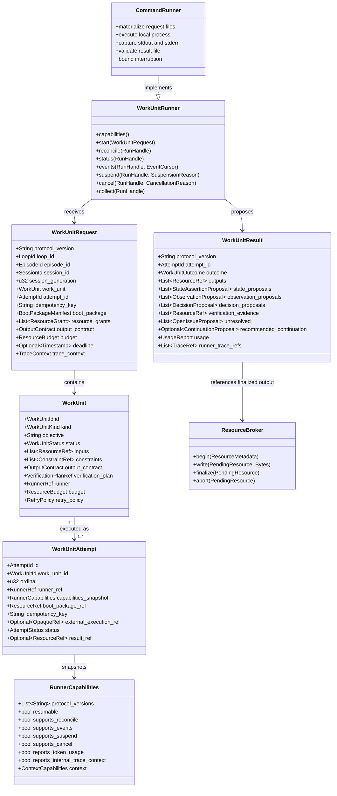

# Work Unit Execution

## Purpose

Work Unit execution is Loopward's public outbound boundary for one externally observable unit of progress. A `WorkUnit` defines explicit inputs, constraints, an output contract, verification requirements, runner selection, and resource limits without exposing the runner's internal topology. A durable `WorkUnitAttempt` records each invocation separately so retries preserve lineage and uncertain external effects can be reconciled. Runner results remain untrusted proposals until Loopward validates their structure, verifies their evidence, and commits any accepted mutation through its own lifecycle authority.

## Position in the System

The [Public API](public-api.md) owns the stable `WorkUnitRunner` contract, request and result DTOs, capabilities, typed errors, protocol versions, cancellation and suspension contracts, and opaque external references. The [Core Domain](core-domain.md) owns durable `WorkUnit` and `WorkUnitAttempt` state and the invariant that Phase One permits at most one active Work Unit per Loop.

The [Runtime Lifecycle](runtime-lifecycle.md) `WorkUnitManager` validates Work Units, persists Attempts, propagates trace context, invokes an explicitly selected runner, and collects structured results. [Context Management](context-management.md) supplies the digest-bound Boot Package and scoped resource grants carried by `WorkUnitRequest`. [Durable State](durable-state.md) persists intent, capabilities, idempotency keys, external execution references, result references, and recovery state. [Verification and Recovery](verification-recovery.md) validates and verifies collected results and reconciles ambiguous execution before the Loop Controller decides whether to accept, remediate, suspend, fail, or continue.

`loopward-runner-command` is the Phase One reference adapter. It depends on `loopward-api`, materializes the public file protocol for a local process, captures its output, and returns public DTOs; it does not gain access to the Loop store or authoritative lifecycle transitions. The [CLI and Testkit](cli-and-testkit.md) composes this adapter and supplies scripted runners and failure injection for protocol conformance.

## Architecture

The following class diagram is schematic: it shows the specified boundary types and their cardinalities, not implementation code.

A `WorkUnit` is the stable unit visible to Loopward and its callers. It can encapsulate a command, coding agent, research service, human process, experiment batch, remote service, or another framework; Loopward does not inspect or model the internal calls, workers, or workflow. Its status is durable, while runner-internal status remains owned by the runner.

Each invocation creates a new `WorkUnitAttempt` with its own identity, ordinal, idempotency key, Boot Package reference, and runner capability snapshot. A retry never overwrites an earlier Attempt. The snapshot preserves the behavior available when that Attempt began even if the runner is upgraded later.

`WorkUnitRunner` is capability-negotiated. Operations such as event streaming, reconciliation, suspension, and cancellation may be unsupported, but the runner must declare that fact and return typed `UnsupportedCapability` errors. `RunHandle` and the stored external execution reference remain opaque to Core; wrappers translate them without importing an external system's state machine.

`WorkUnitRequest` carries identifiers, a bounded Boot Package, scoped resource grants, an output contract, budget, deadline, and trace context. It does not grant unrestricted access to the Loop store. Protocol versions are explicit: incompatible major versions are rejected before execution, and any translating wrapper records its source and target versions.

`WorkUnitResult` is a proposal boundary. It can return resource references, state, observation, and decision proposals, verification evidence, unresolved issues, a recommended continuation, usage, and runner trace references. It cannot commit a Checkpoint, activate a decision, satisfy an acceptance criterion, mark the Work Unit accepted, or declare the Loop complete.

The `ResourceBroker` stages runner output and returns a `ResourceRef` only after finalization. An accepted result may reference only finalized, digest-bound resources. This binds execution output to stable evidence without allowing the runner to mutate authoritative state directly.

## Runtime Flows

1. **Record intent before starting an external effect.**
   1. `WorkUnitManager` validates the selected `WorkUnit`, its `OutputContract`, `VerificationPlanRef`, budget, runner, and Phase One admission rule that no other Work Unit is active.
   2. It queries `WorkUnitRunner.capabilities()` and rejects an incompatible protocol version or a required unsupported capability before execution.
   3. Loopward creates and durably persists a `WorkUnitAttempt` with the runner reference, capability snapshot, Boot Package reference, idempotency key, budget, and expected aggregate revision.
   4. Only after that intent is durable does it call `WorkUnitRunner.start(WorkUnitRequest)`.
   5. The returned external execution reference is persisted immediately. The ordering distinguishes an Attempt never sent, one possibly sent without a recorded handle, an active external execution, and a completed execution awaiting collection.

2. **Validate a request and collect an untrusted result.**
   1. Before `start`, Loopward validates the request schema, protocol version, identifiers, Boot Package manifest, resource grants, output contract, budget, and trace carrier.
   2. The runner performs its internal work and writes output through `ResourceBroker`; only finalized resources receive digest-bound references.
   3. `WorkUnitRunner.collect()` returns a versioned `WorkUnitResult`. Loopward validates its schema, protocol version, Attempt identity, output contract, resource integrity, usage shape, and proposal fields.
   4. Invalid or missing required data produces `InvalidResult` or another typed runner error rather than an authoritative mutation.
   5. A structurally valid result proceeds to the declared verification plan. Only an `ACCEPTED` result can produce accepted Work Unit completion mutations, and the Loop Controller alone selects the lifecycle transition and commits it through a Checkpoint.

3. **Cancel or suspend cooperatively.**
   1. Loopward durably records cancellation or suspension intent before invoking `cancel` or `suspend`.
   2. It records runner acknowledgement separately from the observed external state.
   3. It polls status or reconciles as supported, then records the observed terminal state and residual resources or side effects.
   4. A timeout does not prove execution stopped. If the final effect remains uncertain, the Attempt is treated as ambiguous rather than cancelled or failed by assumption.
   5. Unsupported cancellation or suspension remains a typed capability outcome; policy and the Loop Controller decide the safe durable boundary.

4. **Reconcile an interrupted or ambiguous external effect.**
   1. Recovery loads the latest committed Checkpoint and journal, identifies the active Attempt, and examines its durable intent and external execution reference.
   2. When supported, it calls `WorkUnitRunner.reconcile()` with the existing handle and same idempotency identity.
   3. `NotStarted` permits start with the same idempotency key; `Running` reattaches event collection; `Completed` proceeds to collection and validation; terminal outcomes are recorded without rewriting prior Attempts.
   4. `Unknown` is not treated as failure. If safe repetition cannot be established, the Attempt becomes `Ambiguous` and the Loop suspends for policy or human resolution.
   5. Recovery never repeats an uncertain external effect merely because Loopward lacks its result.

5. **Run the Phase One command-file protocol.**
   1. `loopward-runner-command` materializes a Boot Package directory, a `WorkUnitRequest` file, a resource output directory, and an expected result path.
   2. It supplies Loop, Episode, Session, generation, Work Unit, Attempt, request, result, and resource identifiers through the specified `LOOPWARD_*` environment variables and propagates `TRACEPARENT` and `TRACESTATE`.
   3. The configured local process executes without direct Store access and writes resources and the structured result to the designated paths.
   4. The adapter captures stdout and stderr, performs bounded interruption when requested, and validates the result before returning it as `WorkUnitResult`.
   5. Vendor-specific agent behavior remains outside `loopward-core`; a command, agent, remote service, or wrapper can implement the same public runner contract.

## Key Decisions

### Make the Work Unit externally observable

- **Decision:** A Work Unit is one externally observable unit of progress, not necessarily one model call, agent run, command, or internal workflow.
- **Rationale:** No PR or design doc records a rationale; observed current state: the protocol defines the Work Unit around explicit inputs, constraints, output, lifecycle, and verification while assigning internal calls, workers, workflows, and temporary state to the runner.
- **Consequences:** Complex runners and wrappers can implement the same boundary without leaking their topology into Core, while Loopward retains a stable unit for budgets, lifecycle, verification, and recovery.
- **Ref:** `docs/00-project-charter.md` (sections 5 and 6: Framework Boundaries; Composition Principle); `docs/05-work-unit-and-runner-protocol.md` (sections 1 and 15: Purpose; Acceptance Criteria).

### Treat all runner output as untrusted proposals

- **Decision:** A `WorkUnitResult` cannot directly mutate authoritative Loop state or declare acceptance or completion.
- **Rationale:** No PR or design doc records a rationale; observed current state: the charter makes runner outputs proposals until validation, and the protocol reserves Checkpoint commitment, decision activation, criterion satisfaction, and completion for Loopward's validation and lifecycle gates.
- **Consequences:** Runner-reported success still requires schema validation, integrity checks, and the predeclared verification plan; the Loop Controller remains the sole authority for terminal transitions.
- **Ref:** `docs/00-project-charter.md` (section 8: Foundational Principles); `docs/05-work-unit-and-runner-protocol.md` (sections 7, 8, and 15: Work Unit Result; Resource Broker; Acceptance Criteria); `docs/06-verification-and-recovery.md` (section 2: Result Lifecycle).

### Persist intent before every external effect

- **Decision:** Loopward records the Attempt and its execution identity durably before calling `start`, then persists the returned external reference immediately.
- **Rationale:** No PR or design doc records a rationale; observed current state: the protocol and recovery table require durable intent to distinguish work never started from work that may have started and to reconcile uncertain outcomes without blindly repeating them.
- **Consequences:** Recovery can reuse the same idempotency key, reattach or collect when possible, and suspend instead of duplicating an unsafe side effect.
- **Ref:** `docs/00-project-charter.md` (section 8: Foundational Principles); `docs/05-work-unit-and-runner-protocol.md` (sections 9 and 10: Intent Before External Effect; Reconciliation); `docs/06-verification-and-recovery.md` (sections 12 and 13: Recovery Model; Recovery Decisions).

### Keep proposal authority inside Loopward

- **Decision:** Runners may propose state, observations, decisions, issues, and continuation, but Loopward validates, verifies, and applies any authoritative mutation.
- **Rationale:** No PR or design doc records a rationale; observed current state: framework boundaries assign lifecycle, Checkpoint, verification, continuation, and recovery authority to Loopward and make runner-produced decisions inactive until an explicit gate activates them.
- **Consequences:** External systems retain their own authoritative state, cross-boundary integration uses public outcomes rather than shared internals, and recommendations cannot bypass policy.
- **Ref:** `docs/00-project-charter.md` (sections 5 and 6: Framework Boundaries; Composition Principle); `docs/02-core-domain-model.md` (sections 8 and 10: Observations and Decisions; Acceptance and Verification); `docs/09-public-api.md` (section 13: Wrapper Integration).

### Keep external execution references opaque

- **Decision:** Core stores external execution identities as `OpaqueRef` values and does not copy or interpret another framework's state machine.
- **Rationale:** No PR or design doc records a rationale; observed current state: the composition and wrapper specifications require each system to retain authority over its own state and expose only public outcomes, cancellation, suspension, and trace context across the boundary.
- **Consequences:** Adapters own translation and reconciliation details, runner implementations remain replaceable, and no vendor or orchestration concept enters Loopward Core.
- **Ref:** `docs/00-project-charter.md` (section 6: Composition Principle); `docs/01-system-architecture.md` (section 3: Crate Responsibilities); `docs/09-public-api.md` (section 13: Wrapper Integration).

### Permit only one active Work Unit in Phase One

- **Decision:** A Loop may have at most one active Work Unit in Phase One.
- **Rationale:** No PR or design doc records a rationale; observed current state: concurrent active Work Units, scheduling, fan-out, and fan-in are explicit Phase One non-goals, and the core invariant admits only one active Work Unit.
- **Consequences:** Attempt recovery and lifecycle admission are serialized per Loop; concurrent scheduling and result arbitration remain outside this phase.
- **Ref:** `docs/00-project-charter.md` (section 4: Non-Goals); `docs/02-core-domain-model.md` (section 2: LoopExecution).

## Implementation Notes

- **Invariant:** Work Unit status is durable; runner-internal status is not authoritative Loop state.
- **Invariant:** Every retry creates a new `WorkUnitAttempt` with lineage and never overwrites a prior Attempt.
- **Invariant:** Runner capabilities are snapshotted on the Attempt and are not rewritten after a runner upgrade.
- **Invariant:** Requests carry references and scoped grants, not unrestricted Store access.
- **Invariant:** Only finalized, digest-bound resources may appear in an accepted result.
- **Invariant:** Runner completion, result production, validation, verification, result acceptance, Work Unit acceptance, and Loop completion remain distinct states.
- **Invariant:** Cancellation intent, runner acknowledgement, observed terminal state, and residual effects are recorded separately.
- **Invariant:** A cancellation timeout does not establish that the external execution stopped.
- **Invariant:** `ReconcileOutcome::Unknown` is not failure; unresolved unsafe ambiguity suspends the Loop.
- **Invariant:** Incompatible major protocol versions are rejected before execution, and a translating wrapper records both versions.
- **Phase One constraint:** One Loop has at most one active Work Unit; concurrent execution and scheduling are outside scope.
- **Phase One adapter:** `loopward-runner-command` uses structured request and result files, resource directories, identifier environment variables, trace propagation, stdout/stderr capture, and bounded interruption.
- **Failure model:** `ProtocolError`, `UnsupportedCapability`, `AuthenticationError`, `AuthorizationError`, `ResourceError`, `Unavailable`, `Timeout`, `ExecutionFailed`, `Cancelled`, `AmbiguousExternalState`, and `InvalidResult` remain distinct typed outcomes.

## Spec Deviations

### PR #3's "record confirmed runner failure/cancellation, not Ambiguous" fix closed a gap in the section 10 reconciliation mapping

- **Expected:** `docs/05-work-unit-and-runner-protocol.md` (section 10: Reconciliation) treats `Failed` and `Cancelled` as distinct confirmed `ReconcileOutcome` variants from `Unknown`; only `Unknown` is documented as becoming `Ambiguous` when safe repetition cannot be established. `loopward-core`'s `AttemptStatus` (`crates/loopward-core/src/model.rs`) likewise carries `Failed`, `Cancelled`, and `Ambiguous` as three separate terminal Attempt states.
- **Implemented:** Before PR #3, `RecoveryManager`'s reconciliation handling (`crates/loopward-runtime/src/recovery/reconcile.rs`) matched `ReconcileOutcome::Failed`, `ReconcileOutcome::Cancelled`, `ReconcileOutcome::Unknown`, and a failing `reconcile` call all to the same conservative path, which recorded the Attempt as `Ambiguous` regardless of whether the runner had actually confirmed termination or failure. PR #3 split this: a confirmed `Failed` or `Cancelled` outcome now sets the Attempt's `AttemptStatus` to the matching confirmed value before requesting rotation, so the reducer's `apply_rotation_requested` preserves that already-terminal status instead of falling back to its `Ambiguous` mapping; only `Unknown` and a failed `reconcile` call still take the `Ambiguous`/suspend path.
- **Reason:** PR #3's body, commit list item 2, states the fix directly: "`Failed`/`Cancelled` are recorded durably before `RequestRotation` so they survive the reducer's `apply_rotation_requested` instead of being mapped to `Ambiguous`." The pre-fix code's own comment (visible in the PR #3 diff) called this "a known simplification: a confirmed `Failed`/`Cancelled` report is recorded as durably `Ambiguous` rather than a distinct terminal status Core has no command to produce from here" — no design doc records why PR #2 shipped that simplification rather than the distinct-status handling `docs/05` describes.
- **Impact:** Between PR #2 and PR #3, a runner that had unambiguously reported an Attempt as failed or cancelled during crash recovery was recorded as `Ambiguous` rather than `Failed`/`Cancelled`, which is the state `docs/05` section 10 reserves for outcomes recovery cannot actually confirm. This did not risk unsafe effect repetition (the pre-fix path was conservative, not permissive), but it collapsed a confirmed outcome into the same suspend-and-defer-to-policy handling as a genuinely unknown one. The fix restores the distinction for both `WorkUnitRunner::reconcile` results this page's Runtime Flow 4 describes.
- **Status:** resolved.

### PR #3's "recover finalize from the rename/commit crash window" fix closed a crash-recovery gap in `ResourceBroker.finalize`, which `CommandRunner::collect` depends on

- **Expected:** `docs/05-work-unit-and-runner-protocol.md` (section 8: Resource Broker) states only finalized, digest-bound resources may be referenced by an accepted result. `CommandRunner::collect` (`crates/loopward-runner-command/src/lib.rs`) depends on this: it calls `finalize_log`, which calls `ResourceBroker::finalize` on the captured stdout/stderr logs, and a `WorkUnitResult` cannot be produced until those finalize calls succeed.
- **Implemented:** Before PR #3, `FileResourceBroker::finalize` (`crates/loopward-store-sqlite/src/resource.rs`, referenced not owned by this page) computed the content digest from the pending file, renamed it into place, and only afterward recorded the digest in the `resources` table within one transaction. A crash between the rename and that transaction left the bytes published under their content address but the row still naming the pending URI; a retried `finalize` on the same handle would then fail outright, since `Self::digest_of` could no longer find a pending file to hash. PR #3 added `recover_published_digest`, which persists the digest to the row before the rename, so a retried `finalize` after such a crash can recover the digest and size from the already-published content rather than failing.
- **Reason:** PR #3's body, commit list item 1, states the fix directly: "persist digest before rename so a retried `finalize` on a crashed handle can recover." No design doc records why PR #2's original `finalize` left this window unrecoverable; the new regression test `finalize_recovers_after_a_crash_between_rename_and_metadata_commit` (`crates/loopward-store-sqlite/src/resource.rs`) exercises exactly this simulated crash window.
- **Impact:** Between PR #2 and PR #3, a crash landing in this narrow window during `CommandRunner::collect`'s log finalization (or any other caller of `ResourceBroker::finalize`) would have made the affected Attempt's result permanently uncollectable through simple retry, since the pending file no longer existed for `finalize` to re-hash. The fix makes `finalize` idempotent for a caller that retries with the same in-memory `ResourceHandle`. No current caller does this: `ResourceHandle` is only ever constructed inside `begin()` (`crates/loopward-store-sqlite/src/resource.rs`), and every non-test `finalize` call site (`CommandRunner::finalize_log`; `ControllerImpl::finalize_manifest`/`finalize_result`; `finalize_evidence` in `crates/loopward-runtime/src/verification/gate.rs`; testkit's `finalize_bytes`) runs `begin()` → `write()` → `finalize()` exactly once with no retry that reuses a handle. So a retried `collect()` after such a crash calls `begin()` again, gets a fresh pending URI, and never reaches `recover_published_digest` for the orphaned row — the fix closes the gap at the `ResourceBroker::finalize` level but does not yet make finalization end-to-end crash-recoverable for any real caller.
- **Status:** resolved at the `ResourceBroker::finalize` level; not yet reachable end-to-end, since no current caller retries with a reused `ResourceHandle`.

## Source Anchors

### Specification Sources

- `docs/00-project-charter.md` (sections 3–6 and 8: Goals through Composition Principle; Foundational Principles)
- `docs/01-system-architecture.md` (sections 3, 5, and 6: Crate Responsibilities; Controller Components; Primary Execution Flow)
- `docs/02-core-domain-model.md` (sections 2, 5, 6, 8, and 10: LoopExecution; WorkUnit; WorkUnitAttempt; Observations and Decisions; Acceptance and Verification)
- `docs/05-work-unit-and-runner-protocol.md` (sections 1–15: Purpose through Acceptance Criteria)
- `docs/06-verification-and-recovery.md` (sections 2 and 12–14: Result Lifecycle; Recovery Model through Checkpoint Safety)
- `docs/09-public-api.md` (sections 8 and 13: Outbound Work Unit Boundary; Wrapper Integration)
- `docs/schemas/work-unit-v0.1.yaml` (Work Unit protocol example)
- `docs/schemas/work-unit-result-v0.1.yaml` (Work Unit result protocol example)

### Implementation Sources

- `crates/loopward-runner-command/src/lib.rs` (module: CommandRunnerConfig, CommandRunner, its WorkUnitRunner implementation covering capabilities, start, reconcile, status, events, suspend, cancel, and collect, plus finalize_log and stream_file_into)
- `crates/loopward-runner-command/src/process.rs` (module: TerminationObservation, CaptureReport, RunOutcome, RunEntry, RunRegistry, SpawnRequest, SpawnedRun, spawn, and the supervise task)
- `crates/loopward-runner-command/src/protocol.rs` (module: AttemptLayout, the LOOPWARD_* and TRACEPARENT/TRACESTATE environment variable names, ProtocolVersion, ensure_compatible_version, and read_result)
- `crates/loopward-runner-command/tests/runner_contract.rs` (referenced not owned: the protocol conformance suite exercising start, collect, cancel, capabilities, and reconcile against the documented contract)
- `crates/loopward-api/src/work_unit.rs` (module: WorkUnitKind, WorkUnitStatus, AttemptBudget, ResourceBudget, RetryPolicy, WorkUnit, WorkUnitRequest, WorkUnitOutcome, UsageReport, WorkUnitResult)
- `crates/loopward-api/src/runner.rs` (module: RunnerCapabilities, RunHandle, RunState, RunStatus, ReconcileOutcome, RunnerEvent, RunnerEventPage, SuspensionReason, CancellationReason, RunnerErrorCode, RunnerError, WorkUnitRunner)
- `crates/loopward-core/src/model.rs` (referenced not owned: the durable WorkUnit and WorkUnitAttempt shapes and the AttemptStatus enum, including its Failed, Cancelled, and Ambiguous terminal variants)
- `crates/loopward-runtime/src/recovery/reconcile.rs` (referenced not owned: RecoveryManager's handling of ReconcileOutcome, including the confirmed-Failed/Cancelled recording this page's Runtime Flow 4 depends on)
- `crates/loopward-store-sqlite/src/resource.rs` (referenced not owned: FileResourceBroker's finalize and recover_published_digest, the ResourceBroker implementation CommandRunner::collect finalizes captured logs through)

## Related Pages

- [Public API](public-api.md)
- [Core Domain](core-domain.md)
- [Runtime Lifecycle](runtime-lifecycle.md)
- [Context Management](context-management.md)
- [Durable State](durable-state.md)
- [Verification and Recovery](verification-recovery.md)
- [Observability](observability.md)
- [CLI and Testkit](cli-and-testkit.md)
